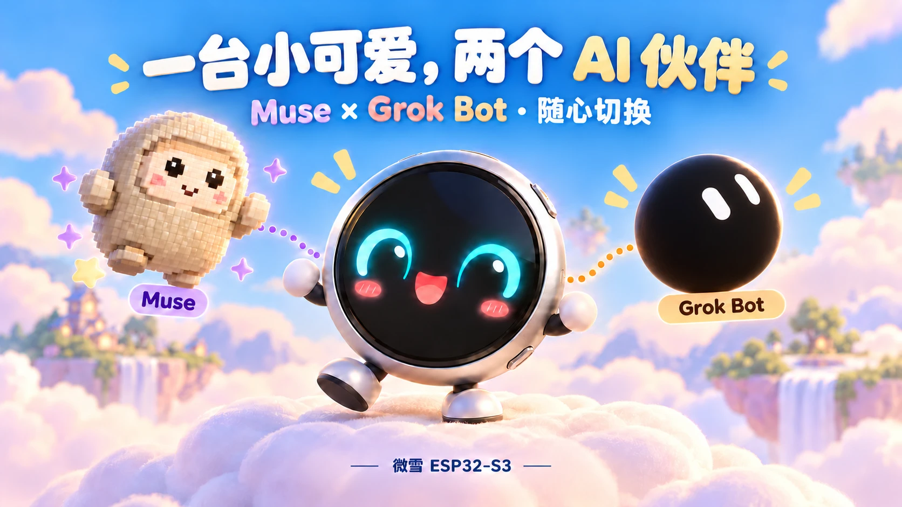
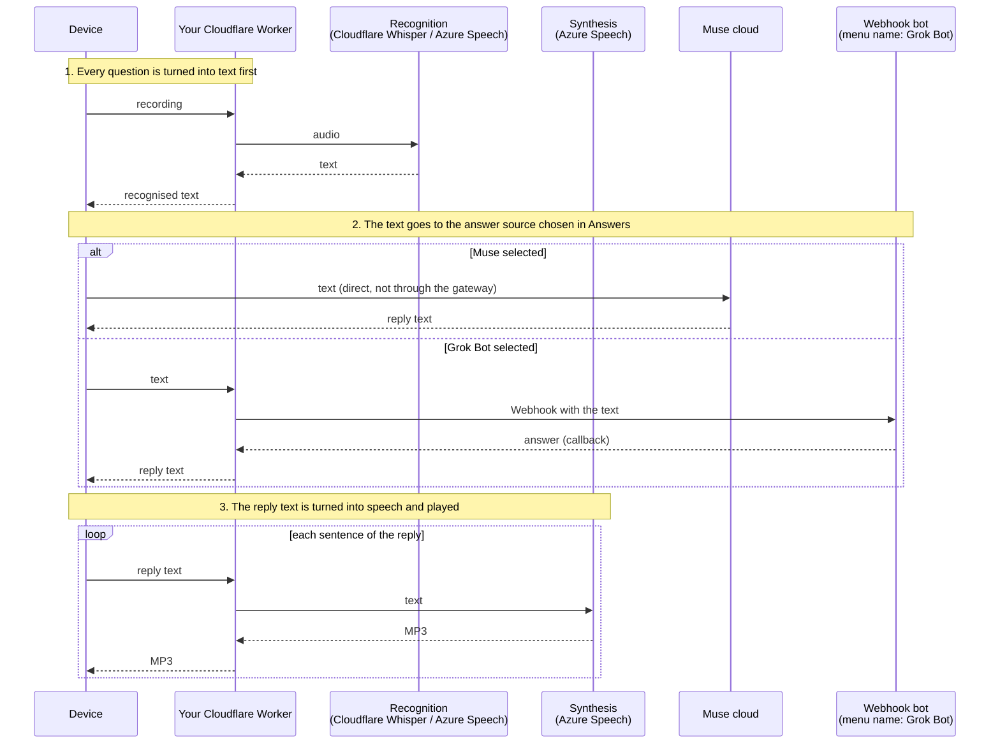
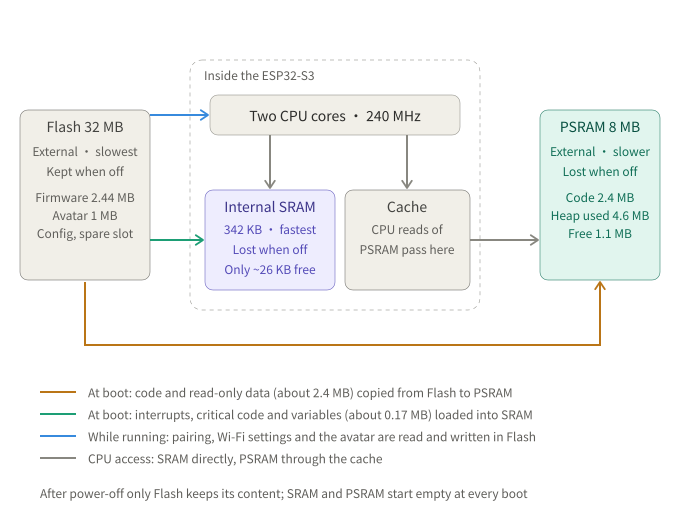
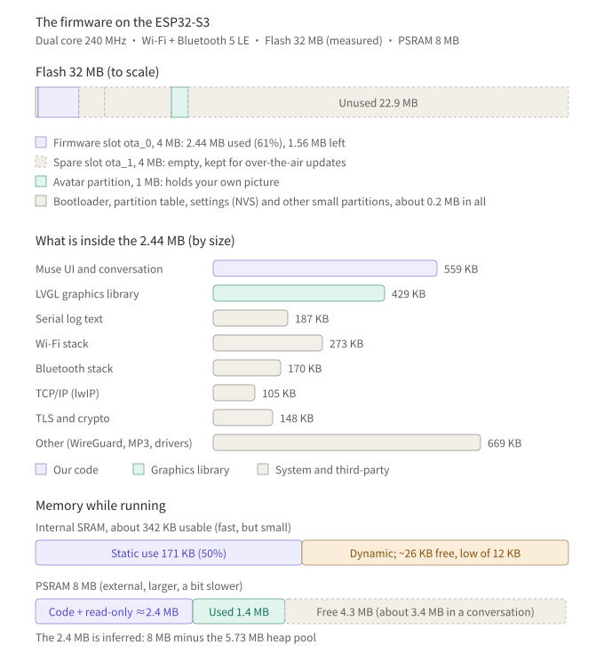

# ESP32 TwinMate

**Two AI companions for your ESP32 gadget. Switch between Muse and Grok Bot, hear spoken replies, stay connected at home or away.**

**English** · [中文](README.md)

<p align="center"></p>

This project is a modified version of the firmware of Meta's [Muse Gadgets SDK](https://github.com/facebookincubator/muse-gadget-sdk), for the **Waveshare ESP32-S3-Touch-AMOLED-1.75C** round touch screen (the only board supported so far). It adds:

- **Text first, then the answerer.** What you say is first recognised by your own gateway (Cloudflare Whisper or Azure Speech, your choice), and the resulting text is handed to Muse or to the Grok Bot. In my own use, Muse's transcription often went wrong and sometimes even hung, so it is better to transcribe first and send Muse the text; Azure's normal free allowance is enough for light use.
- **Grok Bot.** Switch between Muse and the Grok Bot in the device's **Answers** menu. Any bot that accepts an HTTPS Webhook and sends its answer back by callback will do; it does not have to use a Grok model.
- **Spoken replies.** Replies are synthesised with Azure Speech and played on the device. For one person the usage normally stays within the free tiers; check the providers' current terms.
- **Text from Muse on the screen.** The original firmware lets Muse send only pictures. This one also accepts text: the `display.show_text` command shows it as a scrolling teleprompter and can read it aloud, and Muse's own messages can be spoken ("All messages").
- **WireGuard (optional).** When the network you are on cannot reach Muse directly, the device connects through a Linux server of your own. It suits the times you are away from home, where the home network's traffic splitting is not available: public Wi-Fi or a phone hotspot.
- **A Cloudflare gateway.** One gateway that manages the recognition and synthesis above, the Grok Bot settings and WireGuard, with separate device and admin tokens. Deploying it on Cloudflare, in your own account, is recommended; the free tier is enough.
- **Avatars and interactions.** Avatars you can change (including a picture of your own) and full-screen badge pictures. Upload them on the gateway's admin page, move, zoom and rotate them in a round preview first, and sync them on the device with a tap; each device has its own set.
- **One settings file, three commands** to deploy the gateway, build the firmware and flash it. See the [firmware guide](docs/FIRMWARE.md) for every feature, including the stability fixes.

## Disclaimer

It builds on other people's work: Meta's firmware (Apache-2.0), the eyes adapted from [zongzhu-bot](https://github.com/Liu-zhongxian/zongzhu-bot) (MIT), and "All messages" adapted from [wupsbr/waveshare-muse-gadget-sdk](https://github.com/wupsbr/waveshare-muse-gadget-sdk). See [Security and licensing](#security-and-licensing).

This is a personal project and has not been reviewed by Meta. Muse requires your own SDK token and use is subject to the [Gadget SDK Terms](https://gadgets.muse.ai). Voice and conversation data are sent to the cloud services you configure. When you choose a Webhook bot, the recognised text is also sent to that bot.

## How it works

Every question is first turned into text: the device sends the recording to the gateway, which recognises it and returns the text. The device then sends that text to the answer source chosen in **Answers**. With Muse selected, the device sends the text to Muse directly. With the Webhook bot selected, the text goes through the gateway to the bot, which sends its answer back to the Cloudflare gateway by callback. The gateway then sends the reply text to Azure to be turned into speech, one sentence at a time, and it is played on the device.



WireGuard is an optional network path. It does not change the answer source or processing flow above.

## Before you start

| Item | Requirements |
|---|---|
| Board | Waveshare ESP32-S3-Touch-AMOLED-1.75C and a USB-C **data** cable |
| Muse / Grok Bot | A Muse account and an [SDK token](https://gadgets.muse.ai); a Grok Bot account if you use it |
| Cloudflare | An account for deploying the gateway; you can start with the free plan |
| Azure | The key and region name of an [Azure Speech](https://portal.azure.com) resource, for example `eastasia`; Free F0 is an available pricing tier |
| Computer | macOS or Linux; Python 3.8+, Node.js, git and [ESP-IDF 6.0.1](https://docs.espressif.com/projects/esp-idf/en/v6.0.1/esp32s3/get-started/index.html) |
| Webhook bot | Optional. A bot that accepts an HTTPS Webhook and sends its reply back over HTTPS |
| WireGuard server | Optional. Only needed when Muse or Cloudflare cannot be reached directly; see the [server guide](docs/wireguard-server.md) |

To get a Muse token, sign in at [gadgets.muse.ai](https://gadgets.muse.ai) and accept the terms. You can ask the Grok Bot itself to generate how it is called. The tool below handles Cloudflare login, KV creation and Worker deployment. After creating an Azure Speech resource, copy a key from **Keys and Endpoint**. Enter the region name, such as `eastasia`, in the configuration, not the endpoint URL. Provider pages and free allowances may change; check their official sites.

Install ESP-IDF **6.0.1** using Espressif's guide; other versions have not been verified. The tool expects it at `~/esp/esp-idf-v6.0.1`. If you install it elsewhere, update `idf_path` in the configuration.

## Quick start

```bash
git clone https://github.com/burndown/esp32-twinmate.git
cd esp32-twinmate
```

### 1. Create the configuration file

```bash
python3 tools/muse-cloud.py init
```

The tool copies `muse-cloud.example.toml` to `muse-cloud.toml`, sets its permissions to `600`, and generates two random tokens:

- **Device token**: allows the device to access the gateway and is written into the firmware.
- **Admin token**: allows gateway management and is not written into the device firmware.

`muse-cloud.toml` is in `.gitignore`. Do not commit or share it.

### 2. Fill in and check the configuration

Open `muse-cloud.toml` in a text editor and fill in these settings:

| Setting | Value |
|---|---|
| `[muse] sdk_token` | Your Muse SDK token |
| `[speech] azure_key`, `azure_region` | Your Azure Speech key and region name |
| `[speech] recognition` | `"cloudflare"` by default, with no separate recognition key; or `"azure"` |

For a custom bot, fill in the Webhook URL and credentials under `[bot]`. For WireGuard, set `[wireguard] enabled` to `true` and enter the server's address, port and public key. Keep the other settings at their template defaults.

```bash
python3 tools/muse-cloud.py check
```

Resolve any reported problems before continuing.

### 3. Deploy the gateway

```bash
python3 tools/muse-cloud.py gateway
```

The tool opens a browser for Cloudflare login, creates a KV store for settings, configures access tokens, deploys the Worker with Workers AI and Durable Object bindings, and uploads your Azure, bot and WireGuard settings. It prints the Worker URL and writes it to `muse-cloud.toml`. The command can be run again. Leave `[gateway] url` empty: the tool fills it in from what Cloudflare reports, and it overrides a value typed by hand.

**On a machine without a browser** (a remote server, for example), `wrangler login` cannot work. Use a Cloudflare API token instead:

1. In the Cloudflare dashboard open My Profile > API Tokens and create a token with **Workers Scripts: Edit**, **Workers KV Storage: Edit** and **Account Settings: Read**. If you set *Client IP Address Filtering*, it must include this machine's address as Cloudflare sees it (check with `curl https://www.cloudflare.com/cdn-cgi/trace`); otherwise Cloudflare answers error 9109.
2. Enter the token yourself in the terminal, so it does not end up in the shell history or in a chat:

```bash
read -s CLOUDFLARE_API_TOKEN; export CLOUDFLARE_API_TOKEN
export CLOUDFLARE_ACCOUNT_ID=<32-character account ID>
```

The account ID is the 32-character string in the dashboard address (`dash.cloudflare.com/<account ID>/...`) and on the Workers & Pages overview. It is not the account name or your e-mail address. With the token set, the tool skips the login.

Open the admin page at `https://<your-worker>.workers.dev/admin?k=<admin-token>` to test the settings, or run `python3 tools/muse-cloud.py status` to check the gateway.

### 4. Build and flash the firmware

First find the serial port and note it down:

```bash
python3 tools/muse-cloud.py ports
```

It lists the ports it sees (`/dev/cu.usbmodem*` on macOS, `/dev/serial/by-id/*` and `/dev/ttyACM*` on Linux). On Linux the first line also tells you if your account may not open the port: add yourself to the `dialout` group (`sudo usermod -aG dialout $USER`) and log in again. If nothing is listed, use a USB cable that carries data. The `by-id` name stays the same when you plug in other boards, so prefer it on Linux.

```bash
python3 tools/muse-cloud.py firmware --flash /dev/cu.usbmodem1101
```

Replace the serial port with the one you noted. The tool stops at once if that port does not exist, before the long build. The tool fetches the pinned upstream source, applies the patch, generates build settings, then builds and flashes with ESP-IDF. Without `--flash`, it only builds. The first build downloads components; its duration depends on your network and computer.

If WireGuard is enabled and the device has no key yet, the tool generates a key pair and prints a server-side `wg set` command. Run it on the WireGuard server **before the device's first start**, and save the peer configuration in `wg0.conf` as instructed so it survives a server restart.

If esptool cannot connect, hold **BOOT**, tap **RST**, then release **BOOT** to enter download mode and try again. The first flash must write the bootloader, partition table and application together; the tool includes all three.

### Pair in the Muse app

1. After flashing, the device waits for pairing and advertises over Bluetooth as `MuseGadget-` followed by the last six hex digits of its Wi-Fi MAC address, for example `MuseGadget-4245C0`.
2. Add and select the device in the Muse app, then send its Wi-Fi name and password. The device connects to Wi-Fi and Muse.
3. If pairing fails or you need to pair again, follow the upstream firmware's instructions for holding the reset button. The log prompt is `long-press reset to pair again`.

Pairing has been tested on an existing board after erasing its entire flash, not on a new, out-of-the-box board.

## On the device

- **Hold to talk**. On release, the device recognises speech, sends the text to the selected answer source and plays the reply.
- **Swipe left or right** to open settings:
  - **Answers**: Muse / Grok Bot, with Muse selected by default. With Grok Bot selected, the device plays a Chinese acknowledgement before waiting for the reply. A timeout or connection failure shows an error; it does not switch to another answer source.
  - **WireGuard**: Off / Auto / Always. Off disables the tunnel; Auto starts it when Muse or the gateway cannot be reached directly; Always keeps it enabled.
  - **Avatar**: Eyes / Pixel Muse / Picture. Upload the picture on the gateway's admin page, tap **Get picture** on the device and choose **Picture**; `tools/make-avatar-img.py` also makes one.
  - **Badge**: full-screen pictures; tap for the next one; tap **Sync with gateway**, or hold a picture for about a second and a half, to copy the pictures from the gateway. Needs a build with the badge partition.
- Status icons and button hints are hidden by default and appear when you touch the screen.

The gateway's fixed spoken prompts are currently in Chinese. The configuration template and command-line tool use English. See the [gateway guide](docs/GATEWAY.md) for changing the prompts.

## Upload an avatar and badge pictures from the admin page

Open the admin page (`https://<your-gateway>/admin?k=<admin token>`) and its Appearance tab:

1. **Choose the device first.** Avatars and badge pictures are kept per device. A device names itself with `d=<node id>` when it asks for pictures (for example `homelink-4245c0`); the first time it asks it appears in the drop-down, named `Device` plus the last six digits, and it can be renamed or removed. A device without an id (older firmware) gets the "older single set"; pictures uploaded before this existed are there, and a button copies them to a device.
2. **Choose pictures and edit them in the round preview.** Drag to move, use the slider or the wheel to zoom (below 1 shows more of the picture with black around it), rotate, reset, and tick "overlay the time" to see how a clock face would sit on it. The preview is what gets uploaded: the browser crops it to 233×233 (avatar) or 466×466 (badge), blacks out the corners outside the round screen, converts it to the format the device uses and uploads it; the picture does not pass through any third party.
3. **Fetch it on the device.** Avatar: Settings > Avatar > **Get picture**, wait for Done, and choose **Picture** as the avatar (Eyes and Pixel Muse do not show a picture). Badge: Settings > Badge > **Sync with gateway**, or hold a picture for about a second and a half. A sync copies only the pictures whose version changed, and a picture deleted on the gateway disappears from the device at its next sync.

The Badge page needs a build with the badge partition (`partitions_muse_badge.csv`, 4 MB, up to 9 pictures). To sync over the public address, whatever sits in front of the gateway must let `GET /badge/list` and `GET /badge/<n>` through; the admin page itself is protected by the admin token.

## Connect a custom Webhook bot

The device menu calls this answer source **Grok Bot**. Any bot that implements the following callback protocol can be used; no particular model is required.

1. The gateway sends a `POST` to the configured Webhook URL with `Authorization: Bearer <credentials>` and a JSON body of `{"message": "<recognised text>\n\n(callback instructions…)"}`.
2. The bot copies the complete callback URL from the message and sends a `POST` to `https://<your-worker>.workers.dev/bot-reply/<id>/<one-time-token>`, with `{"reply": "<answer>"}` and `Content-Type: application/json`. No additional authorisation header is needed. The callback URL can be used once and expires after 10 minutes.
3. The gateway first makes the device play an acknowledgement, then holds the connection for up to 270 seconds. The device speaks the answer when it arrives, or reports a timeout if the bot does not reply.
4. If the bot restricts outbound requests, add the callback's Worker hostname to its allowlist. Otherwise the callback will be blocked.

How one Grok Bot question uses KV and Durable Objects is explained in the [technical details](docs/GROK-BOT.md).

The Webhook URL must use HTTPS and a public hostname. This flow has been tested with a real Webhook bot implemented as a Cursor automation. The repository does not include a stand-alone example bot server.

## Main configuration settings

| Section | Setting | Meaning |
|---|---|---|
| `[muse]` | `sdk_token` | Muse SDK token |
| `[gateway]` | `name` | Worker name |
| | `url`, `kv_id` | Filled in during deployment; `url` can also use a custom domain |
| | `device_token`, `admin_token` | Separate tokens generated by `init` |
| `[speech]` | `azure_key`, `azure_region`, `voice` | Azure Speech key, region and voice name |
| | `recognition`, `language` | Recognition service: `cloudflare` / `azure`; language code, such as `zh-CN` |
| `[bot]` | `webhook_url`, `auth` | Bot Webhook URL and credentials |
| | `callback_base` | Only needed when the bot must use a callback endpoint other than the default Worker URL |
| `[wireguard]` | `enabled`, `endpoint`, `port`, `server_public_key` | Whether to enable WireGuard, and the server connection details |
| | `address`, `subnet` | Device tunnel address and address prefix; use a different `address` for each device |
| | `mode`, `via_tunnel` | Default mode: `off` / `auto` / `always`; whether gateway requests also use the tunnel |
| | `private_key` | Device private key generated by the build tool when needed |
| `[firmware]` | `idf_path`, `upstream`, `upstream_commit`, `workdir` | ESP-IDF path, upstream repository, pinned commit and build directory |
| | `model_answers`, `home_ssid` | Keep the template defaults: `false` and an empty string |

## Firmware and memory

The ESP32-S3 has three kinds of storage: an external **Flash** (keeps its content when powered off, slowest), the **SRAM** inside the chip (fastest, but small) and an external **PSRAM** (larger, a bit slower). The firmware is kept in Flash; at boot the code and read-only data are copied into PSRAM and run from there, and only the interrupt handlers and critical code stay in SRAM. This is how they relate:

<p align="center"></p>

And this is how much space the firmware takes: the Flash partitions, what the 2.44 MB firmware contains, and how SRAM and PSRAM are used while it runs.

<p align="center"></p>

The figures come from a build of 2026-10-22 (after merging upstream e6fe517) and from the device's serial log; other builds differ slightly. The 32 MB of Flash was read from the board with esptool (the official specification says 16 MB), and the partition table uses only the first 9 MB or so. The 2.4 MB of code and read-only data in PSRAM is inferred. Internal SRAM is the tight spot: only about 26 KB is free while it runs, which is why large buffers such as the speech buffers live in PSRAM.

## Troubleshooting

- **The device keeps restarting**: read the serial log at 115200 baud. `ESP_NETIF_BRIDGE_EN` must be enabled; the current firmware forces it on. If needed, remove the generated `build/` directory and rebuild. Do not keep your own source changes in that directory.
- **The device needs pairing again after a flash**: this can happen, especially if the previous firmware kept restarting. Pair again in the Muse app; rebuilding is not required.
- **Restoring a flash backup causes `HTTP 401`**: pairing again invalidates the old pairing tokens. Restoring an old NVS backup afterwards makes the device use those invalid tokens. Do not rely on an old flash backup to restore pairing.
- **The SDK token is invalid**: it must be 48 characters, start with `mgst_`, and end in one of `A E I M Q U Y c g k o s w 0 4 8`. Copy it again from [gadgets.muse.ai](https://gadgets.muse.ai), then run `check`.
- **Deployment fails with Cloudflare error 1010 or a connection error**: access to `workers.dev` can be intermittent on some networks. Run the deployment command again.
- **`check` says nothing is wrong, but `gateway` fails at once**: look at the error. An empty `[gateway] name` and a wrong account ID are the usual causes.
- **Cloudflare error 9109 "Cannot use the access token from location"**: the API token has an IP address filter that does not include this machine. Add the address shown by `curl https://www.cloudflare.com/cdn-cgi/trace`, or remove the filter.
- **The board powers off when the talk key is held for 10 seconds**: on this board the talk key is the PWR key, which is wired to the power-management chip, and the chip cuts power after a 10-second hold whatever the firmware does. Release within 10 seconds. (The firmware can end the turn by itself at 9 seconds; we did that in our own build, and the patch in this repository does not have it yet.)
- **Uploaded in the admin page, nothing changed on the device**: check first which device is chosen at the top of the Appearance tab (not "the older single set", unless the device has older firmware without an id). For the avatar, tap **Get picture** on the device and choose **Picture**; for badge pictures tap **Sync with gateway**, they do not update by themselves.
- **Badge sync fails when away from home**: the device uses the gateway's public address, and whatever sits in front of the gateway must let `GET /badge/list` and `GET /badge/<n>` through, otherwise they get 404.
- **The bot never replies**: check the Webhook URL, credentials and whether the bot is allowed to reach the callback's Worker hostname.

## Costs and verification status

The gateway is intended for personal use. You can start with the Cloudflare free plan and Azure Speech F0. Whether you stay within the allowances depends on request volume, recorded audio duration and synthesised character count. See the [gateway guide](docs/GATEWAY.md) for limits and billing details. WireGuard server costs are separate.

The following status is summarised from existing test records dated 2026-10-21:

| Scenario | Status |
|---|---|
| Apply the patch to clean upstream `e6fe517` and build with the tool (Badge, device id, Bluetooth on demand and the rest) | Passed (build only, not flashed) |
| The same patch (with the clock, timer and stopwatch pages and the 1-second press minimum): applied to clean `e6fe517` and built for the Waveshare 1.75C and the M5Stack StopWatch | Passed; the same code runs on the author's StopWatch and 圆圆 (flashed), a short press and a normal sentence both tried |
| Apply the patch to clean upstream `fa07304`, generate settings and build | Passed, including a build with WireGuard enabled |
| Tool commands `init`, `check`, `gateway`, `status`, `firmware` | Passed, including deployment to a real free Cloudflare account; the test Worker was deleted |
| Flash with the tool and complete a Muse voice interaction | Passed with Cloudflare Whisper recognition, Azure synthesis and WireGuard disabled |
| Erase the same board's entire flash, then build, flash, pair and interact from scratch | Passed; not tested on a new, out-of-the-box board |
| Upload an avatar and badge pictures from the admin page (cropped, converted and uploaded to the chosen device by the browser) | Passed: automated tests in a real browser, and a real fetch on the device |
| A device syncing badge pictures and fetching its avatar from the gateway on the home LAN | Passed: one 434 KB picture in about 1.4 seconds on the device, no crash |
| Syncing badge pictures over the public address while away | Not verified; the forwarder lets the GETs through, tested from the command line |
| Editing with the mouse (dragging) in the admin page | Not verified: zoom, move and rotate were driven by script, nobody dragged by hand |
| Several devices, each with its own avatar and pictures | Gateway side passed (38 simulated checks); two devices are registered, the other board's picture sync is not verified yet |
| Use Grok Bot on the device after flashing with the tool | Not verified; the Worker-side bot flow has been tested |
| Enable WireGuard and use the tool-generated key on the device | Not verified |
| A user with no related experience follows only this guide from scratch | Not verified |
| Other boards / native Windows | Not adapted / not verified; Windows may require WSL |

See the [validation record](docs/VALIDATION.md) for measurements, the initial failure and its fix.

## Where the firmware patch in this repository stands

`firmware/muse-cloud.patch` is now for upstream `e6fe517` and contains: the Badge page and its sync from the gateway, the device id (`d=`), reloading the avatar at once after a fetch and filling the whole screen (`CONFIG_MUSE_PHOTO_FILL`, enlarged once when loaded), Bluetooth only on demand (`CONFIG_MUSE_BLE_ON_DEMAND`), ending a turn after 9 seconds of holding the talk key (on the 1.75C the talk key is the PWR key, and the power chip cuts power after 10 seconds of holding it) and the internal-RAM savings configuration. It applies to clean upstream and builds (flashing was not repeated with it); the runtime checks of these features come from builds of the same code on the author's device. The patch also carries the clock (with weather), timer and stopwatch pages for the M5Stack StopWatch, and the device id sent as an `X-Device` header (chat, recognition, synthesis and WireGuard enrolment all carry it, so the gateway applies per-device settings and can block a lost gadget), and presses shorter than 1 second are not sent (almost always an accidental touch). The stopwatch page's screen and logic come from [VolosR/M5Stopwatch](https://github.com/VolosR/M5Stopwatch), used with the original author's agreement; see `esp32/components/muse/volos/NOTICE.md`.

## Repository layout

| Path | Contents |
|---|---|
| `muse-cloud.example.toml` | Shared configuration template for the gateway and firmware |
| `tools/muse-cloud.py` | Configuration checks, gateway deployment, firmware builds and flashing |
| `worker/` | Cloudflare gateway: recognition, synthesis, bot forwarding, WireGuard enrolment, avatars and admin page |
| `firmware/muse-cloud.patch` | Firmware patch for upstream commit `e6fe517` (the full commit id is in `firmware/UPSTREAM_BASE`) |
| `tools/scan-private.sh` | Scans for LAN addresses, local paths, user names, tokens, private keys and MACs before a push |
| `worker/test/smoke.sh` | Runs the gateway's smoke test locally with workerd (tokens, device registration, block and unblock, tunnel key) |
| `.github/workflows/ci.yml` | Runs on every push: the privacy scan, the gateway smoke test, and whether the patch applies to upstream |
| `docs/` | [Gateway guide](docs/GATEWAY.md) · [Firmware guide](docs/FIRMWARE.md) · [WireGuard server setup](docs/wireguard-server.md) · [Validation record](docs/VALIDATION.md) |

The firmware and gateway share one repository so their interfaces and protocols can be maintained together. Use the pinned upstream commit, and keep the firmware patch and gateway code on the same repository version.

## Security and licensing

- `muse-cloud.toml` contains tokens, the Azure key and the WireGuard private key. Generated build settings and firmware also contain credentials. Do not commit, publish or share those files.
- The device token is written into the firmware and allows recognition, synthesis, chat, WireGuard enrolment and avatar downloads. Gateway management uses a separate admin token. Protect the full admin-page URL, which includes that token.
- Gateway and tool code is licensed under MIT; see [LICENSE](LICENSE).
- `firmware/muse-cloud.patch` modifies the upstream Muse Gadgets SDK and follows its [Apache-2.0](https://github.com/facebookincubator/muse-gadget-sdk/blob/main/LICENSE) licence. The 16×16 Chinese font data comes from [GNU Unifont](https://unifoundry.com/unifont/) 16.0.04 (GPLv2+ with the font-embedding exception, also OFL-1.1). The eyes' shapes and gestures are adapted from [zongzhu-bot](https://github.com/Liu-zhongxian/zongzhu-bot) (MIT). WireGuard uses [esphome/wireguard](https://components.espressif.com/components/esphome/wireguard) (BSD-3). The “All messages” feature is adapted from two commits of [wupsbr/waveshare-muse-gadget-sdk](https://github.com/wupsbr/waveshare-muse-gadget-sdk).
- The stopwatch page is based on [VolosR/M5Stopwatch](https://github.com/VolosR/M5Stopwatch) (the repository has no licence file; used with the original author's agreement); its fonts are regenerated from that project's G7 Segment and Modum fonts.
- “Muse”, “WireGuard” and other trademarks belong to their respective owners. Provider API integrations were informed by [xiaozhi-esp32-server](https://github.com/xinnan-tech/xiaozhi-esp32-server) (MIT).
