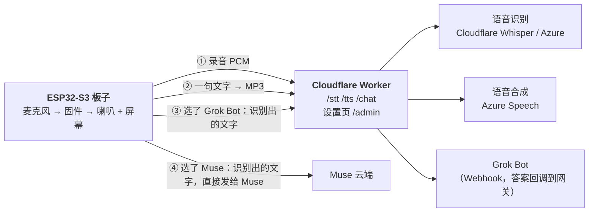

# muse-gadget-cloud

让 Meta 的 [Muse Gadgets SDK](https://github.com/facebookincubator/muse-gadget-sdk) 的 ESP32 设备，在**保持 Muse 原本界面**（头像、字幕、按住说话）的前提下，把“听、想、说”换成你自己选的云服务：语音识别、大模型（可联网搜索）、语音合成，各自可以换厂商，不需要自己架服务器。

这是个人实验，不是官方项目，没有经过 Meta 审核。使用 Muse 需要你自己的 SDK token，并遵守 [Gadget SDK Terms](https://gadgets.muse.ai)。

## 它是什么

两部分：

- `worker/`：**Cloudflare 版网关**，只做语音识别、语音合成和 Grok Bot。固件只会说几个 HTTP 接口，网关把它们翻译成云服务的 API，并带一个**设置页**，在浏览器里选识别服务商、填 Azure 密钥、Grok Bot 的 Webhook 和 WireGuard 服务器信息。识别用 Cloudflare Workers AI 的 Whisper（免费、不要密钥）或 Azure Speech，合成用 Azure Speech。没有大模型。
- `worker-home/`：**完整版网关**，我自己在家里用：多家大模型（含联网搜索）、阿里和火山的识别与合成、本地 SenseVoice，可以跑在家里的服务器上（见下面"家里版网关"）。它带大模型，所以也能在 Muse 连不上或 Bot 没响应时由模型接手。
- `firmware/`：给上游 Muse 固件打的补丁。按住说话后，录音不再上传给 Muse，而是交给网关识别，识别出的文字交给网关里的大模型，回复一句一句送去合成语音播放，界面和字幕还是 Muse 的。网关连不上时，会把文字交给 Muse 云端（回退）。



## 支持的服务商（完整版 `worker-home/`）

`worker/`（Cloudflare 版）只有 Cloudflare Workers AI（Whisper）和 Azure Speech 两家；下表是完整版的。

| | 阿里云百炼 | 火山引擎 | 微软 | 其他 |
|---|---|---|---|---|
| 大模型 | 通义千问，支持联网搜索（`enable_search`） | 方舟豆包，联网搜索走 Responses API 的 `web_search` 工具 | | DeepSeek；任意 OpenAI 兼容服务（含家里的 Ollama） |
| 语音识别 | Qwen3-ASR-Flash | 豆包录音文件识别极速版 | **Azure Speech**（短音频 REST，与语音合成同一把密钥和区域）；**Cloudflare Workers AI**（Whisper large-v3-turbo，免费、不需要密钥，只能在部署到 Cloudflare 的网关上用） | **本地服务器**（SenseVoice 经 sherpa-onnx，WAV 进、`{"text"}` 出） |
| 语音合成 | CosyVoice（WebSocket，输出 16 kHz MP3） | 豆包语音合成（HTTP v1） | **Azure Speech**（Neural 音色，REST，16 kHz MP3） | |

**用 CLIProxyAPI 接入 ChatGPT / Gemini 订阅（仅限家里网关，我自己实测过一次）**：[CLIProxyAPI](https://github.com/router-for-me/CLIProxyAPI) 在内网提供 OpenAI 兼容接口，云端 Worker 够不到它，所以只能配在家里网关上。两种用法：

- **Gemini + 谷歌搜索（推荐，约 3 秒）**：服务商选"自定义"，接口地址填 `http://<你的内网地址>:8317/v1`，模型填 `gemini-3-flash`，"额外参数"填 `{"tools":[{"google_search":{}}]}`，不勾网关自己的联网搜索。
- **GPT + 搜索（约 17 秒才出第一个字，因为先搜索后写）**：服务商选"Responses 接口"，模型填 `gpt-5.6-sol` 一类，勾选联网搜索，额外参数可填 `{"reasoning":{"effort":"low"}}`。Gemini 走 Responses 接口时**不会搜索**，要用上一种。

这是把订阅账号经非官方代理当 API 用，可能违反服务条款，额度和封号风险自行评估。

网关会在系统提示里给模型当天日期，并要求涉及"今年、最新"的问题先搜索；回复里的 `*`、`#`、反引号会被去掉，避免字幕和语音里出现格式符号。

Azure 的音色很多：设置页的"刷新完整列表"会用你的密钥向 Azure 取回全部音色（几百个）供选择。

> **精简后的 Cloudflare 版（`worker/`）在测试 Worker 上重新测过**：健康检查、设置页和设置接口（按段合并保存）、Cloudflare Whisper 识别（短句约 1.2 到 2.9 秒，冷启动 7 秒）、Azure 识别、Azure 合成（约 2.4 秒，3 段拼接）、测试按钮、真机器人（约 19 秒拿到回答）、WireGuard 申请（同一把密钥两次得到同一个地址）都通过；录音近乎静音时直接返回空。设置页本身我只请求到了 HTML 和接口，**没有在浏览器里点过**。

**验证状态（如实说明）**：阿里云整套、Azure 合成、本地 SenseVoice 识别，以及固件在 Waveshare ESP32-S3-Touch-AMOLED-1.75C 上的完整一轮（识别、回答、播报），我在真机上都用过。**火山方舟、火山语音识别和合成、DeepSeek 是照着开源实现写的，没有用真实密钥跑过**，设置页每一项都有"测试"按钮，请先测再用。火山方舟的联网搜索接口尤其没验证。固件里"识别回退"、"Muse 等太久改用网关的模型"、"Muse 连接中途断开后继续"这几条保险是按代码写的，没有在真机上人为制造故障验证。

## 纯云端部署（不需要家里的电脑）

只需要：圆圆（或别的支持的板子）、一个 Muse 账号、一个免费的 Cloudflare 账号、一个 **Azure Speech** 资源。合成用 Azure；识别可以用 Azure（同一把密钥），也可以用 **Cloudflare Workers AI 的 Whisper**（免费、不需要密钥）。回答者只有 **Muse** 和 **Grok Bot（Webhook 机器人）** 两个，不需要大模型。

1. 部署 `worker/`（见下面"部署网关"），在设置页的"密钥"里填 Azure Speech 密钥；语音合成选 **微软 Azure**，区域选离你近的（亚洲可用 `eastasia`）；语音识别选 **Cloudflare Workers AI**（免费，不用密钥）或 **微软 Azure**。
2. 固件的配置：复制 `firmware/sdkconfig.cloud-only.example` 成一个**不提交**的文件，填上 Worker 的地址、网关令牌和 WireGuard 服务器信息（它已经包含关掉模型、网关请求走隧道、Cloudflare 证书链这几项），编译时把它放在 `SDKCONFIG_DEFAULTS` 的最后。关掉模型即 `CONFIG_MUSE_MODEL_ANSWERS=n`。这样设置 → Answers 只有 Muse 和 Grok Bot 两项；选 Muse 时录音识别后文字**直接发给 Muse**，不经过网关的 `/chat`；Muse 连不上或 Bot 没响应时，圆屏显示错误（`CAN'T REACH MUSE`、`GROK BOT DIDN'T ANSWER`），**不会**换别的回答者接手。
3. `MUSE_HOME_SSID` 留空，三个地址都填 Worker 的地址（`https://你的worker.workers.dev/stt?k=令牌` 等）。
4. Grok Bot 的回调直接打到 Worker 的 `/bot-reply`（Worker 本来就有公网 HTTPS 地址，不需要中转站点）。在 Bot 的"允许访问的外部地址"里加入你的 `*.workers.dev` 域名。

**免费额度（需要自己核对最新数字）**：
- Azure Speech 免费档（F0）按[官方定价页](https://azure.microsoft.com/pricing/details/cognitive-services/speech-services)：语音识别每月 5 小时音频，神经语音合成每月 50 万字符，同时只能有 1 个实时请求。按一次问答录音约 5 秒、回答约 600 字估算，约合每月 3600 次提问或约 800 次长回答，**这是估算，不是实测**。
- Cloudflare Workers 免费版按[官方限制页](https://developers.cloudflare.com/workers/platform/limits/)：每天 10 万次请求，每次请求 10 毫秒 CPU 时间（等待网络不算），每次请求最多 50 个子请求。KV 每天约 1000 次写入的数字我只在第三方文章里见过，请以官方为准。一轮问答约 1 次识别加十几次语音请求，每天几千轮也用不完请求数。
- **没验证的风险**：每次请求 10 毫秒 CPU 够不够拼接多段 MP3 和做流式转换，我还没在真正的 Cloudflare 上量过；Grok Bot 的回调状态放在 KV 里，KV 最终一致，回调可能晚一点被等待的请求看见。

**Cloudflare Workers AI 的识别**：用 `@cf/openai/whisper-large-v3-turbo`，按[官方定价](https://developers.cloudflare.com/workers-ai/platform/pricing/)每音频分钟 46.63 个 Neurons，免费每天 10,000 个，约 200 分钟。用同一段中文录音经真实的 Worker 测过：识别正确（简体），稳定后约 1.2 秒，冷启动那一次 5.2 秒。**不要选 `@cf/openai/whisper`（不是 turbo 版）**，同一段话它输出繁体还错了一个字。语音合成不建议用 Workers AI 的 MeloTTS：它输出 44.1 kHz 的 WAV，而固件只解 MP3，Worker 免费版的 10 毫秒 CPU 又编不了 MP3，需要固件另加 WAV 播放，目前没做。

**验证状态（如实说明）**：Azure 识别经网关用一段中文录音测过，识别正确，网关本地响应 1.2 到 2.8 秒（含从 Mac 到 Azure 东亚区域的往返）。**纯云端的完整一轮已在真机上跑通**（Waveshare 1.75C，关闭模型的固件，所有请求只指向一个部署在 Cloudflare 免费账号上的 Worker，没有家里的服务器）：录音 3.1 秒，识别用 Cloudflare Whisper，松手后约 4.6 秒拿到正确文字；文字直接发给 Muse，约 0.7 秒后确认收到；Muse 的第一段文字约 +13 秒，第一声约 +17 秒（其中 Worker 取第一段语音约 3.9 秒）；一段 1469 字的回答分 11 次向 Worker 取语音（Azure 合成），念了 94 秒，整轮 112 秒，Worker 没有报超出 CPU 限制，设备内部内存最低 16K。对比家里网关：识别慢约 4 秒，合成每段慢约 1 到 2 秒。**只测了 Muse 这一个回答者**。Grok Bot 的回调状态在 Cloudflare 上改用 Durable Object（`worker/wrangler.toml` 里的 `BOT` 绑定和迁移；免费版可用 SQLite 版的 Durable Object），没有这个绑定时退回 KV（最终一致，回答可能晚到最多一分钟，家里的网关就是这种）。这个新路径用本机 Worker 加一个假机器人测过：先说确认话，约 4.6 秒后收到回答，第二次回调返回 403（一次性令牌），错令牌返回 403；**用真机器人在 Cloudflare 免费账号上也测通了**：一个"今天几月几号"的问题，确认话立即出，约 21.9 秒后拿到回答，Worker 这一段 CPU 时间只有 1 到 4 毫秒；Bot 的回调打到 Worker 的 `/bot-reply`，返回 200。这是用 `curl` 直接请求 Worker 测的，没有经过圆圆。**Bot 的"允许访问的外部地址"里必须加入你的 `*.workers.dev` 域名**，否则 Webhook 能发出去，但回调被拦，Worker 会等满 270 秒后说"小黑一直没有回话"（我第一次测就是这样）。

## 不在家也能用（家里网关的公网入口）

家里网关只监听内网地址。想让圆圆离家后继续用家里的识别、大模型和语音合成，可以给它一个公网入口，并让固件**按连的 Wi-Fi 名选地址**：是家里的 Wi-Fi 就走内网，其他网络一律走公网，与 Muse 是否配对、能否连上无关。

1. **HTTPS 转发**：`home/gw-proxy.mjs`（Node，无依赖）监听一个公网端口，只放行 `POST /chat`、`/tts`、`/stt`，其余一律 404；每个来源地址每分钟最多 60 次请求，连续 10 次令牌错误（403）会被封 10 分钟。用 `systemd --user` 常驻（`home/gw-proxy.service`，把 `YOUR_DOMAIN` 换成你的域名，把转发目标写进环境变量 `UP_HOST`）。
2. **证书**：家庭宽带的 80/443 通常是封的，所以用 [acme.sh](https://github.com/acmesh-official/acme.sh) 的 **DNS 验证**签 Let's Encrypt 证书；续期后给转发服务发 `SIGHUP` 即可热加载，不用重启。密钥只放在你自己服务器上权限 600 的文件里。
3. **路由器**：加一条 `公网端口 → 网关所在机器:同一端口` 的 DNAT 转发。如果公网地址是动态的，用 DDNS 让域名跟着走。
4. **固件**：Kconfig 里设置 `MUSE_HOME_SSID`（家里 Wi-Fi 名），以及三个备用地址 `MUSE_STT_FALLBACK_URL`、`MUSE_BRAIN_FALLBACK_URL`、`MUSE_TTS_FALLBACK_URL`（指向公网入口）。没设置 `MUSE_HOME_SSID` 时，固件改为对内网地址做 1.5 秒的 TCP 连接探测，不通就在 90 秒内改用备用地址。内网地址上请求失败（没收到任何数据）时，也会在备用地址上重试一次。

我在真机上用手机热点验证过：识别、回答、语音合成都走了公网入口并正常播出。**注意**：曾试过 Cloudflare 隧道做这个入口，从我家出口到 Cloudflare 绕美国，`/chat` 要 4 到 9 秒、`/tts` 要 4 到 40 秒且波动很大，所以改成了直接开端口。你的网络不同，结果可能不同。

## 接一个云端代理（Webhook 机器人）

有些代理（比如 Grok Bot）不是同步问答：收到 Webhook 后过几十秒才回话，而且回话不在 HTTP 响应里。网关为此做了一条通路（只在家里网关上配，需要上面的公网入口）：

1. **触发**：固件在不是家里 Wi-Fi 时，每次请求带 `"away": true`，网关把这一轮交给机器人；在家时只有说出机器人的名字（"问小黑……"）才交给它，其余仍走普通大模型。机器人联系不上时自动退回普通大模型。
2. **发出**：网关 `POST` 你的 Webhook，请求体 `{"message": "<你说的话> + 一段说明"}`，说明里要机器人用 HTTP `POST` 把答案发到 `https://<你的域名>:<端口>/bot-reply/<id>/<令牌>`，请求体 `{"reply": "…"}`（`text`、`message` 字段也认）。`id` 和令牌是**每次请求一对的一次性令牌**，10 分钟内有效，只能成功一次，不需要网关令牌。令牌放在路径里而不是查询参数里，是因为有的 Webhook 会把 `&` 转义成 `&amp;`；旧的 `?id=&t=` 写法仍然兼容。转发服务要把 `/bot-reply` 加进白名单，否则回调会被它拒绝成 404。
3. **等待**：网关**先**让设备念一句"收到，我去问小黑，请稍等。"，再发 Webhook（Webhook 发不出去时，网关接着用普通大模型把答案补在同一条回复里），然后保持连接，最长等 270 秒，机器人回调后把答案接着流给设备念出来；超时会说"小黑一直没有回话"。固件的读超时因此放宽到 300 秒，并且逐字节读流：ESP-IDF 的 `esp_http_client_read` 会一直等到缓冲区读满才返回，一句很短的确认话后面跟着几十秒空白，就会被卡在读取里，要等答案到了才被念出来。
4. **配置**：网关环境变量 `GROKBOT_URL`、`GROKBOT_AUTH`（Webhook 地址和密钥）、`BOT_CALLBACK_BASE`（公网入口的完整前缀）。密钥放在你自己服务器权限 600 的文件里，不要进仓库。机器人如果有"允许访问的外部地址"名单，要把你的域名加进去。
5. **可选：经一台有公网 IP 的中转服务器（`GROKBOT_VIA`）**。用 SSH 反向隧道把家里网关接到中转服务器（`home/bot-tunnel.service`），中转服务器的 nginx 按 `home/relay-nginx.conf` 放行回调路径、转发 Webhook。好处：回调走标准 443 和固定地址，不依赖家里的公网 IP 和入站端口；Webhook 也从路由更好的服务器发出。网关设置 `GROKBOT_VIA=http://127.0.0.1:18790` 后先走中转，中转不通时自动直连；`BOT_CALLBACK_BASE` 改成中转域名，`BOT_CALLBACK_FALLBACK` 写网关自己的公网地址：Webhook 改走直连时，给机器人的回调地址也同步换成这个，免得答案送到一条已经断了的路上。两种情况我都实测过（中转正常 15 秒；停掉隧道后 41 秒，答案仍然回得来）。两个坑：nginx 反向代理默认用 HTTP/1.0，有的机器人会回 `426 Upgrade Required`，要加 `proxy_http_version 1.1`；Webhook 路径是机密，中转站点要关掉访问日志。
6. **一个坑**：有的机器人所在的网络会把域名解析成 `198.18.x.x` 这类假地址（本地代理的假 IP）。网关会用公共 DNS 查到真实 IP，写进说明里，让机器人用 `curl --resolve` 直连。

我用真实的 Grok Bot 测过一次：发出、回调、接着念，全程 18.6 秒。设备上完整的"离家"那一轮，写这段时还没有实测。

## 部署网关

需要 Node.js、一个 Cloudflare 账号，以及你要用的云服务的密钥。

```bash
cd worker
npx wrangler login
npx wrangler kv namespace create muse-gateway-cfg     # 把输出的 id 填进 wrangler.toml
openssl rand -hex 24                                  # 生成一个访问令牌
npx wrangler secret put GATEWAY_TOKEN                 # 粘贴上面的令牌
npx wrangler deploy
```

然后打开 `https://<你的worker>.workers.dev/admin?k=<令牌>`，一个页面里设置全部：
- **这个网关**：固件里要填的三个地址，以及 Workers AI 和 Durable Object 两个绑定是否在。
- **语音识别**：Cloudflare Workers AI（Whisper，免费）或 Azure Speech，和语言。
- **语音合成**：Azure 的区域、音色（可以拉取完整音色列表）和 Azure Speech 密钥。
- **Grok Bot**：Webhook 地址和授权（存成密钥，页面只显示末四位）、可选的回调域名，以及“测试 Grok Bot”按钮（会真的问它一句）。机器人的“允许访问的外部地址”里要加上页面里显示的这个网关的域名。
- **WireGuard**：服务器公钥、地址、端口、隧道网段；下面列出申请过隧道的设备，每个设备一行 `wg set` 命令和“复制命令”按钮，你把它在 WireGuard 服务器上执行就是批准。页面里不存任何私钥。

每一项都有“测试”按钮。保存是按段合并的，只改你改的那一段。**保存后最多约一分钟生效**：Cloudflare KV 的读取有缓存，设备列表也一样。

要点：

- 所有请求都要带 `?k=<令牌>`，否则返回 403，防止别人刷你的额度。
- 页面里保存的密钥放在你自己 Cloudflare 账号的 KV 里（明文），页面只显示末四位。更严格的做法是用 `wrangler secret put AZURE_SPEECH_KEY`、`GROKBOT_URL`、`GROKBOT_AUTH` 等（网关也认这些环境变量，WireGuard 的服务器信息也可以用 `WG_SERVER_PUB`、`WG_ENDPOINT`、`WG_PORT`、`WG_SUBNET`）。
- Azure 免费档同时只能有 1 个实时请求，网关对合成最多并行 3 路，被限流（429）时会退避重试。
- Whisper 对静音会编出“字幕志愿者”之类的字幕，网关在录音几乎没有声音时直接返回空，并过滤这类字幕。

## 家里版网关（推荐）

同一份 Worker 代码可以不经 Cloudflare，直接在家里的服务器上用 Cloudflare 开源的本地运行时（workerd，通过 `wrangler dev --local`）跑起来，只在局域网里可访问，见 `home/`：

```bash
mkdir -p ~/home-gateway/src && cd ~/home-gateway
cp /path/to/repo/home/package.json /path/to/repo/home/wrangler.toml .
cp /path/to/repo/worker-home/src/index.js /path/to/repo/worker-home/src/admin.html src/
npm install
printf 'GATEWAY_TOKEN=%s\n' "$(openssl rand -hex 24)" > .dev.vars && chmod 600 .dev.vars
# then install home/muse-home-gateway.service (fill in YOUR_USER and YOUR_LAN_IP) as a systemd unit
```

设置页在 `http://<内网地址>:8787/admin?k=<令牌>`，设置和密钥存在 `./state`（磁盘上的模拟 KV，明文）。为什么要有它：**云上的 Worker 对国内的服务商很慢**。实测（作者的网络，到 Cloudflare 的线路落在美国西海岸）同一句话合成云上 2.6 到 6.4 秒，家里版 0.7 到 1.3 秒；阿里云识别 2 到 4 秒对 0.5 秒；"回到 Muse"的 503 应答 0.4 秒加 TLS 握手对 15 毫秒。内网用 http，ESP32 还省掉每次请求的 TLS 握手。

## "回到 Muse"开关

设置页最上面的开关。打开后，网关对固件的第一次询问返回 503，固件就把识别出的文字交给 Muse 自己的助手回答；你选的大模型保留着，关掉开关就切回来。如果 Muse 在设定时间（`MUSE_BRAIN_GIVEUP_SECONDS`，默认 30 秒）内没有回一个字，固件会带 `muse_down: true` 再问一次，这时网关用你选的大模型回答，不让回合失败。限制：识别和播报仍走这里选的服务商，录音不会上传给 Muse。

## 本地语音识别（可选）

固件可以把录音直接发给家里的识别服务（最快，录音不出家门），失败再回退到网关。如果想让**云上**的网关也用家里的识别服务，需要一条回家的通路，`homebox/asr_gate.py` 是一个带令牌校验的小网关（只听本机端口），再用 Cloudflare Tunnel 把一个域名接到它。**注意**：作者的家里出口到 Cloudflare 的线路很远，这条路径实测每个请求约 3.5 秒，比内网直连慢得多，所以仅作备用。

## 固件

补丁基于上游提交 `fa07304`，改动主要在 `esp32/components/muse/`（命令注册和处理在 `esp32/main/`）：识别、对话、合成三个客户端，Kconfig 选项，Unifont 16×16 中文字库，字幕和回复长度调整，以及这些保险：

- **识别回退**：`MUSE_STT_URL` 失败（或 5 秒没响应）就用 `MUSE_STT_FALLBACK_URL`。
- **Muse 等待时间**可配（`MUSE_BRAIN_GIVEUP_SECONDS`）。
- **Muse 连接中途断开**：还没收到字就改问网关；已经在回答就把收到的念完，而不是让整个回合失败。
- **`display.show_text` 命令**：让 Muse 把文字直接显示在圆屏上，不用渲染成图片。黑底白字，超过一屏就像提词器一样逐行向上滚，手指可以拖，点一下关闭；最长约 4000 字节（约 1300 个汉字）。默认同时用网关的 TTS 朗读（`speak: false` 只显示不念），滚动跟着朗读进度走（按字数比例估算，不是逐字对齐）。圆屏固件（Muse 显示后端）且没有开 TM1637 时启用。
- **所有消息（推送）**：设置 → Sound → All messages（默认关）。打开后，Muse 在没有回合等待它时发来的助手消息（Muse 主动写，或在**主对话**里打字的回复）会唤醒屏幕并用网关 TTS 念出来，空闲时也保持连接。实现改编自 [wupsbr/waveshare-muse-gadget-sdk](https://github.com/wupsbr/waveshare-muse-gadget-sdk) 的两个提交。线程会话里的消息只以 `sessions.updated` 摘要到达，不会被念。已在 Waveshare 1.75C 上用主对话实测过一次。
- **冻屏修复**：上游 PR #34（`muse_lcd_bands.c`）。LVGL 等刷屏时空转，可能把发送屏幕数据的任务饿死，屏幕冻住而其余固件照常。改成信号量阻塞。1.75C 上只验证了能编译、能运行，还没有长时间待机的数据。
- **眼睛头像**（设置 → Sound → Eyes，默认开，关掉就是原来的像素头像）：两只白色的眼睛，会眨眼、转眼神，形状跟着 Muse 的状态变（待机、聆听、思考、说话、出错），说话时眼睛随声音大小起伏。触摸手势：单击开心、双击惊讶、长按生气、按住拖动眼神跟着手指、上滑惊讶、下滑困倦（左右滑仍然是进入设置页）。倾斜板子视线跟着转，左右用力摇 4 下会发晕（用板上的 QMI8658，目前只适配了 Waveshare 1.75C）。眼睛的形状和手势改编自 [zongzhu-bot](https://github.com/Liu-zhongxian/zongzhu-bot)（MIT 许可，相关源文件头部保留了版权和许可说明）。
- **等待计时圈**：松手就开始计时，周围的圈 60 秒画满；等待期间回到思考状态，答案念出来时清零。
- **主屏干净**：状态图标、状态文字、喇叭按钮和按键提示平时隐藏，碰一下屏幕淡入，4 秒后淡出；隐藏期间点不到这些控件，第一下碰屏幕让它们出现，下一下才能操作。
- **不在家时不再后台试连 Muse**：设置了 `MUSE_HOME_SSID` 且连着别的 Wi-Fi 时，VM 会话、令牌刷新、Noise 会话和聊天会话的后台重连都暂停，回到家里的 Wi-Fi 后恢复。开机时连上 Wi-Fi 之前那一次试连无法避免。
- **WireGuard 隧道**（设置 → WireGuard：Off / Auto / Always）：给连不上 Muse 服务器的网络用。Auto 下，设备在联网后快速 TCP 连一下 Muse 的服务器，连得上就直连，连不上才拉起隧道；Always 一直走隧道；在 `MUSE_HOME_SSID` 那个 Wi-Fi 上 Auto 永远不走隧道。隧道起来后所有新连接都从服务器出去，域名也改由隧道里的 1.1.1.1 / 8.8.8.8 解析（路由器的 DNS 可能返回假地址或被污染的答案），换网络时重新判断。用的是 ESP-IDF 组件 [esphome/wireguard](https://components.espressif.com/components/esphome/wireguard)（BSD-3）。**配置不用在圆屏上输密钥**：设备自己生成密钥对（私钥不离开设备），向网关 `POST /wg/enroll` 提交公钥，网关回服务器公钥、地址和分给它的隧道 IP；没配置时设备会自己申请，菜单里的 Get config 可以重新申请，Forget 清掉。最后一步由人在 WireGuard 服务器上批准这把公钥：`GET /wg/peers` 会列出申请过的公钥和对应的 `wg set` 命令。网关要设 `WG_SERVER_PUB`、`WG_ENDPOINT`（服务器公网地址）、可选 `WG_PORT`、`WG_SUBNET`（默认 `10.77.0.`）。服务器端的搭法见 `docs/wireguard-server.md`。**纯云端配置下**（网关在 Cloudflare 上）：Kconfig 打开 `MUSE_GATEWAY_VIA_TUNNEL`，去网关的请求也走隧道，Auto 的判断会把网关一起算上（Muse 或网关任一个直连不通就起隧道）。**服务器地址也可以直接写在固件里**（`MUSE_WG_ENDPOINT`、`MUSE_WG_PORT`、`MUSE_WG_SERVER_KEY`、`MUSE_WG_ADDRESS`），这时不向网关申请，设备只是生成自己的密钥对；设置 → WireGuard 页会显示服务器、隧道地址和完整公钥（开机日志里也会打印），你把公钥加到服务器上当 peer 即可。**想在刷机前就把一切配好**：对每台设备运行一次 `tools/make-wg-config.py --address 10.77.0.2 --server-key 服务器公钥 --endpoint 服务器地址 --append my-cloud.defaults`，它生成这台设备的密钥对（纯 Python，用 RFC 7748 的测试向量自检，生成的公钥我用真正的 `wg pubkey` 核对过一致），把配置（含私钥，`CONFIG_MUSE_WG_PRIVATE_KEY`）追加进你的构建配置，并打印服务器上要执行的那一行 `wg set`。刷机前先在服务器上执行，设备一开机就能连上，不需要任何第一次启动时的步骤。私钥在固件和那个配置文件里，不要提交。`CONFIG_MUSE_WG_DEFAULT_MODE` 决定出厂时的 WireGuard 模式（0 关、1 自动、2 一直开）。已在 Waveshare 1.75C 上、家里的 Wi-Fi、Always 模式下验证过：握手、解析出真实地址、连上 Muse。**Auto 模式在真正连不上 Muse 的外网（热点）里的判断，还没有实测。**
- **谁来回答**（设置 → Answers：Muse / Grok Bot / Gemini，默认 Muse，在家在外都生效）：选 Muse 就问 Muse（连不上再回退到网关的模型，在外时用 WireGuard 连 Muse）；选 Grok Bot 每句话交给 Webhook 机器人；选 Gemini（网关配置的模型）既不问 Muse 也不问机器人。WireGuard 的 Auto 只在选 Muse 时才起隧道。去网关的请求（识别、对话、语音）绑定在 Wi-Fi 网卡上，隧道起着也直接走公网地址，不绕隧道服务器，只有连 Muse 的连接走隧道（在 bg 上抓 `wg0` 的包验证过：只有 Muse 的地址和隧道里的 DNS）。网关 `POST /chat` 新增 `gemini: true` 字段。
- **主页形象**（设置 → Avatar：Eyes / Pixel Muse / Picture）：Picture 是你自己的一张圆形图（233×233 RGB565，存在新增的 `avatar` 分区里，需要刷一次分区表）。`tools/make-avatar-img.py 照片.jpg` 裁成圆形并转成设备格式，`GW_AVATAR_URL='http://网关:8787/avatar/set?k=令牌' ... --upload` 传到网关（只在局域网，公网转发不放行 `/avatar/set`），设备上点 Get picture 下载。没有图片时选 Picture 会显示眼睛。
- **取语音缓冲 640 KB**。这个补丁早期版本里单段语音缓冲只有 256 KB（128 kbps 下 16 秒），超长的一句话会被无声截掉尾巴，下一段照常播放，听起来就是"丢了中间一句话"；现在够装下一段最长的语音，并且万一再被截断会在日志里报警。

```bash
git clone https://github.com/facebookincubator/muse-gadget-sdk.git
cd muse-gadget-sdk && git checkout fa07304
git apply /path/to/muse-gadget-cloud/firmware/muse-cloud.patch
```

复制 `firmware/sdkconfig.cloud.example` 成一个你**不提交**的文件，填上网关地址和令牌，然后按上游文档构建。以 Waveshare 1.75C 为例（ESP-IDF 6.0.1）：

```bash
cd esp32
idf.py -B build -DIDF_TARGET=esp32s3 -DSDKCONFIG=build/sdkconfig \
  -DSDKCONFIG_DEFAULTS="sdkconfig.defaults;devices/sdkconfig.muse;devices/sdkconfig.muse-waveshare-s3-175c;/path/to/your-cloud.defaults" build
python -m esptool --chip esp32s3 --port <串口> -b 460800 write-flash "@flash_args"   # 在 build 目录里
```

其中 SDK token 要写进 `CONFIG_GADGET_SDK_TOKEN`（放你自己的未提交文件里）。刷机后在 Muse App 里配对。已知现象：用 esptool 只刷应用分区后，配对偶尔会丢，需要重新配。

## 为什么要 `CROSS_SIGNED_VERIFY`

网关在 `*.workers.dev` 上，Cloudflare 发的是 Google Trust Services 经 GlobalSign 交叉签名的证书链。固件默认没打开 `CONFIG_MBEDTLS_CERTIFICATE_BUNDLE_CROSS_SIGNED_VERIFY`，会报 `Failed to verify certificate`（-0x3000）。示例覆盖文件里已经打开。设备没有墙上时钟，证书日期校验是关着的。

## 延迟与取舍

- 一轮对话的时间主要花在三处：识别（约 2 到 4 秒，含上传和 TLS）、大模型第一个字（普通问题不到 1 秒，需要真正联网搜索时 3 到 6 秒）、第一句合成。网关把长句拆成 10 到 40 字的小段并行合成再拼接，换来更短的首句等待。
- 拼接后的 MP3 在小段衔接处是否有可听见的瑕疵，我没有用耳朵逐段确认。
- 你的语音和对话内容会发给你选择的云服务商，这与使用 Muse 自己的云不同。

## 许可与致谢

- `worker/` 和 `worker-home/` 为 MIT 许可（见 [LICENSE](LICENSE)）。
- `firmware/muse-cloud.patch` 是对上游 Muse Gadgets SDK 的修改，遵循上游的 [Apache-2.0](https://github.com/facebookincubator/muse-gadget-sdk/blob/main/LICENSE)；其中的 16×16 中文字库数据来自 [GNU Unifont](https://unifoundry.com/unifont/) 16.0.04（GPLv2+ 带字体嵌入例外，另有 OFL-1.1 双许可）。
- 各家服务商的接口写法参考了 [xiaozhi-esp32-server](https://github.com/xinnan-tech/xiaozhi-esp32-server)（MIT）和字节跳动的 agentkit-samples（Apache-2.0）。
