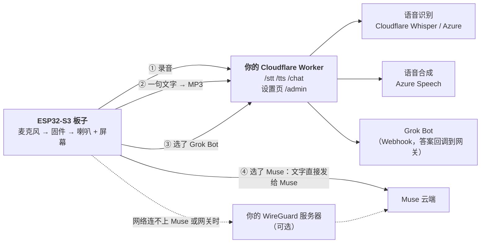

# muse-gadget-cloud

给 Meta 的 [Muse Gadgets SDK](https://github.com/facebookincubator/muse-gadget-sdk) 的 ESP32 设备（目前适配 **Waveshare ESP32-S3-Touch-AMOLED-1.75C** 圆屏）加上：

- **不用自己的服务器**：识别、语音合成放在你自己的免费 Cloudflare 账号和 Azure 账号上。
- **三种回答者**：Muse 自己的助手，或一个你接入的 Webhook 机器人（Grok Bot），在圆屏的设置里切换。
- **连不上 Muse 的网络里也能用**：设备自带 WireGuard，只在需要时连到你自己的一台海外服务器。
- 眼睛头像（会眨眼、跟着手指和倾斜转动）、可换的头像（包括你自己的圆形图）、等待计时圈、干净的主屏、`display.show_text` 提词器、所有消息推送……（完整列表见 [docs/FIRMWARE.md](docs/FIRMWARE.md)）。

这是个人项目，不是官方的，没有经过 Meta 审核。使用 Muse 需要你自己的 SDK token，并遵守 [Gadget SDK Terms](https://gadgets.muse.ai)。你的语音和对话内容会发给你选择的云服务商，这与只用 Muse 自己的云不同。

## 这个仓库里有什么

| 路径 | 是什么 |
|---|---|
| `muse-cloud.example.toml` | **一个配置文件**：网关和固件的所有设置都在这里 |
| `tools/muse-cloud.py` | 读这个配置，一条命令部署网关、一条命令编译（和刷写）固件 |
| `worker/` | **Cloudflare 网关**（纯云端版）：识别、合成、Grok Bot、WireGuard 登记、头像、设置页 |
| `firmware/muse-cloud.patch` | 给上游 Muse 固件（提交 `fa07304`）打的补丁 |
| `worker-home/`、`home/` | 另一种部署：跑在家里服务器上的完整版网关（多家云服务商、本地识别、大模型），见 [docs/HOME-SERVER.md](docs/HOME-SERVER.md) |
| `docs/` | [GATEWAY.md](docs/GATEWAY.md) 网关细节 · [FIRMWARE.md](docs/FIRMWARE.md) 固件功能和手工编译 · [wireguard-server.md](docs/wireguard-server.md) 搭 WireGuard 服务器 · [HOME-SERVER.md](docs/HOME-SERVER.md) 家里版 |

**固件和网关在同一个仓库里**，因为它们是一对：固件和网关之间有一套约定（设备令牌与管理令牌、`/chat` 的 503 和错误标记、`/wg/enroll`、`/avatar`），改一边就要改另一边。放在一起，一次提交就能保持它们互相兼容，你拿到的永远是一对能配合的版本。



## 开始之前要准备的

| 东西 | 说明 |
|---|---|
| 板子 | Waveshare ESP32-S3-Touch-AMOLED-1.75C，一根 USB-C 数据线 |
| Muse | 一个 Muse 账号，和你的 **SDK token**（在 [gadgets.muse.ai](https://gadgets.muse.ai) 取，`mgst_` 开头共 48 个字符） |
| Cloudflare | 一个免费账号（网关跑在这里） |
| Azure | 一个 Speech 资源（免费档 F0 就够）的**密钥**和**区域**（比如 `eastasia`），语音合成用它 |
| 电脑上 | Python 3.8+、Node.js（脚本通过 `npx wrangler` 部署）、git、[ESP-IDF 6.0.1](https://docs.espressif.com/projects/esp-idf/en/v6.0.1/esp32s3/get-started/index.html) |
| Grok Bot | **可选**。一个接收 Webhook、过一会儿把答案 POST 回来的机器人。不用的话，Answers 里只有 Muse |
| WireGuard 服务器 | **可选**。只有你的网络连不上 Muse 或 Cloudflare 时才需要：一台海外 Linux 服务器，见 [docs/wireguard-server.md](docs/wireguard-server.md) |

## 用法：四步

```bash
git clone https://github.com/burndown/muse-gadget-cloud.git
cd muse-gadget-cloud
```

**第 1 步：生成配置文件**

```bash
python3 tools/muse-cloud.py init
```

它把 `muse-cloud.example.toml` 复制成 `muse-cloud.toml`（权限 600，已在 `.gitignore` 里，**不要提交**），并生成两个随机令牌：设备令牌（会写进固件）和管理令牌（只在你的浏览器里）。

**第 2 步：填写 `muse-cloud.toml`**

用文本编辑器打开，每一项上面都有说明。最少要填这几个：

| 位置 | 填什么 |
|---|---|
| `[muse] sdk_token` | 你的 Muse SDK token |
| `[speech] azure_key`、`azure_region` | Azure Speech 的密钥和区域 |
| `[speech] recognition` | `"cloudflare"`（免费，不要密钥，默认）或 `"azure"` |

可选的：`[bot]` 填 Grok Bot 的 Webhook 地址和授权；`[wireguard]` 把 `enabled` 改成 `true`，填服务器地址、端口和服务器公钥。然后运行：

```bash
python3 tools/muse-cloud.py check        # 告诉你还缺什么
```

**第 3 步：部署网关**

```bash
python3 tools/muse-cloud.py gateway
```

它依次：登录 Cloudflare（会开浏览器）→ 建一个存设置的 KV → 设置两个令牌 → 部署 Worker（带 Workers AI 和 Durable Object 绑定）→ 把你的 Azure、Bot、WireGuard 设置推送进去。结束时它会打印 Worker 的地址并写进 `muse-cloud.toml`。之后用 `python3 tools/muse-cloud.py status` 随时检查。

设置页：`https://<你的worker>.workers.dev/admin?k=<管理令牌>`，每一项有“测试”按钮。如果用了 Grok Bot，要在机器人的“允许访问的外部地址”里加上你的 `*.workers.dev` 域名，否则它的答案送不回来。

**第 4 步：编译并刷固件**

```bash
python3 tools/muse-cloud.py firmware --flash /dev/cu.usbmodem1101    # 串口名按你的电脑填
```

它依次：取上游固件并检出指定提交 → 打补丁 → 把 `muse-cloud.toml` 变成编译设置 → 用 ESP-IDF 编译 → 刷机。第一次编译要下载组件，需要几分钟。如果开了 WireGuard 且还没有密钥，它会为这台设备生成密钥对，并打印**一行要在 WireGuard 服务器上执行的命令**（先执行，再刷机，设备开机就能连上）。

不加 `--flash` 就只编译。esptool 连不上时：按住 BOOT，点一下 RST，再松开 BOOT，进入下载模式。第一次刷要把引导程序、分区表和应用一起刷（脚本就是这样做的）。

刷好后，在 Muse App 里配对。

## 遇到问题时

- **设备不停重启**：看串口日志（115200）。如果你自己改过编译设置，先确认没有关掉 `ESP_NETIF_BRIDGE_EN`（固件现在会强制打开它）。把 `build/` 目录删掉重新跑 `firmware` 是安全的。
- **刷机后设备要重新配对**：偶尔会发生，尤其是前一个固件反复重启过。在 Muse App 里重新配对即可，不用重新编译。
- **`firmware` 报 SDK token 无效**：token 是 48 个字符，`mgst_` 加 43 个，最后一个字符有限制；从 [gadgets.muse.ai](https://gadgets.muse.ai) 重新复制。
- **`gateway` 报 Cloudflare 的 1010 或连不上**：从有些网络直接访问 `workers.dev` 会时好时坏，重新运行即可（脚本是可重复运行的）。
- **Grok Bot 一直说“没有回话”**：机器人的“允许访问的外部地址”里没有你的 `*.workers.dev` 域名。

## 在设备上怎么用

- **按住说话**，松手后设备会识别、再交给你选的回答者，念出答案。
- 圆屏**左右滑进入设置**：
  - **Answers**：Muse，或 Grok Bot（默认 Muse）。选 Muse 时文字直接发给 Muse；选 Grok Bot 时先念一句“收到，我去问小黑”，等机器人回答；机器人没回话或联系不上，屏幕显示错误，**不会**换别的回答者接手。
  - **WireGuard**：Off / Auto / Always。Auto 只在连不上 Muse 或网关时才拉起隧道；如果你在 `[firmware] home_ssid` 里填了家里 Wi-Fi 的名字，在那个 Wi-Fi 上永远不拉。
  - **Avatar**：Eyes / Pixel Muse / Picture（你自己的圆形图，用 `tools/make-avatar-img.py` 做并上传（上传要用管理令牌），在设置里点 Get picture）。
- 主屏平时是干净的：状态图标、按键提示碰一下才出现。

## 费用和免费额度

纯云端版是为免费账号设计的，但额度要自己核对最新数字，细节见 [docs/GATEWAY.md](docs/GATEWAY.md)。简单说：Cloudflare Workers 免费版每天 10 万次请求；Workers AI 的 Whisper 每天约 200 分钟；Azure Speech 免费档每月识别 5 小时、合成 50 万字符。一个人日常使用远远够，但“送给很多人”时要注意每个人各部署一份。

## 安全须知

- `muse-cloud.toml` 里有令牌、Azure 密钥、WireGuard 私钥：**不要提交，不要发给别人**。脚本生成的 `build/` 目录里的编译设置、编译出的固件里也有设备令牌，同样不要上传。
- 设备令牌写在固件里：谁拿到设备谁就拿到它。所以它**只能**用于识别、合成、对话、登记和下载头像；管理（设置页、密钥、登记批准）只认管理令牌。
- 令牌必须是长随机串；`init` 生成的就是。

## 验证到哪一步了（如实说明）

| 项 | 状态 |
|---|---|
| 补丁打在干净的上游 `fa07304` 上，用脚本从 `muse-cloud.toml` 生成设置，从零编译，固件里有补丁的功能和新分区 | 通过（2026-10-21，包括 WireGuard 打开的组合） |
| `tools/muse-cloud.py` 的 `init`、`check`、`gateway`（真实部署到 Cloudflare 免费账号）、`status`、`firmware` | 通过（测试用的 Worker 已删除） |
| 网关、WireGuard、回答者（Muse、Grok Bot；家里版还有模型）在圆圆上的完整一轮 | 通过，细节见 [docs/GATEWAY.md](docs/GATEWAY.md) 和 [docs/FIRMWARE.md](docs/FIRMWARE.md) |
| 用脚本的 `firmware --flash` 把纯云端固件刷到圆圆上，圆圆稳定运行，选 Muse 完整一轮（识别用 Cloudflare Whisper，合成用 Azure，都经你自己的 Worker）：1 句 11 个字的问题，Muse 的回答分 20 次取语音，念了 55 秒，整轮 135 秒，设备内部内存最低 12K | 通过（2026-10-21，`wireguard.enabled = false`）。**第一次尝试失败过**：脚本漏了 `CONFIG_ESP_NETIF_BRIDGE_EN`，设备约每 4 秒重启一次，还丢了配对，要在 Muse App 里重新配对；已修（固件自己要求这个选项），第二次通过 |
| 对一块擦除过的全新板子做第一次完整刷机、配对 | 没有验证 |
| 一个没有任何相关经历的人，只照这份文档从零做一遍 | **没有验证** |
| 其它板子 | 没有适配 |
| Windows 上的 `tools/muse-cloud.py firmware`（它通过 `bash` 调用 ESP-IDF 的 `export.sh`） | 没有验证，大概需要在 WSL 里用 |

## 许可与致谢

- `worker/`、`worker-home/`、`tools/` 为 MIT 许可（见 [LICENSE](LICENSE)）。
- `firmware/muse-cloud.patch` 是对上游 Muse Gadgets SDK 的修改，遵循上游的 [Apache-2.0](https://github.com/facebookincubator/muse-gadget-sdk/blob/main/LICENSE)；其中的 16×16 中文字库数据来自 [GNU Unifont](https://unifoundry.com/unifont/) 16.0.04（GPLv2+ 带字体嵌入例外，另有 OFL-1.1 双许可）；眼睛的形状和手势改编自 [zongzhu-bot](https://github.com/Liu-zhongxian/zongzhu-bot)（MIT）；WireGuard 用 [esphome/wireguard](https://components.espressif.com/components/esphome/wireguard)（BSD-3）；“所有消息”改编自 [wupsbr/waveshare-muse-gadget-sdk](https://github.com/wupsbr/waveshare-muse-gadget-sdk) 的两个提交。
- “Muse”“WireGuard”等是各自所有者的商标。各家服务商的接口写法参考了 [xiaozhi-esp32-server](https://github.com/xinnan-tech/xiaozhi-esp32-server)（MIT）。
