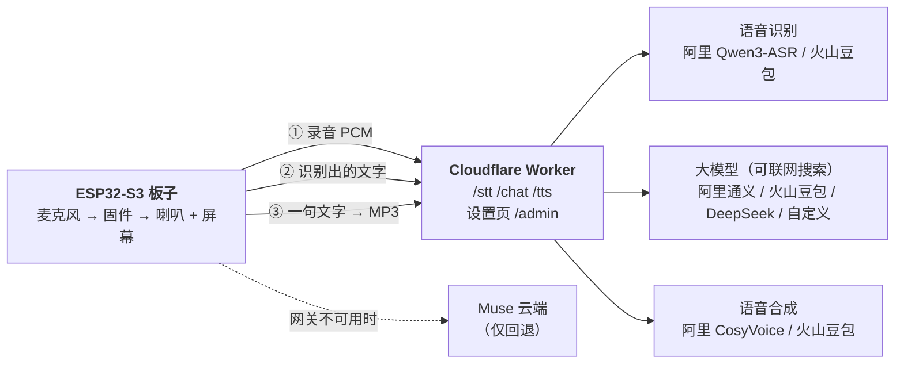

# muse-gadget-cloud

让 Meta 的 [Muse Gadgets SDK](https://github.com/facebookincubator/muse-gadget-sdk) 的 ESP32 设备，在**保持 Muse 原本界面**（头像、字幕、按住说话）的前提下，把“听、想、说”换成你自己选的云服务：语音识别、大模型（可联网搜索）、语音合成，各自可以换厂商，不需要自己架服务器。

这是个人实验，不是官方项目，没有经过 Meta 审核。使用 Muse 需要你自己的 SDK token，并遵守 [Gadget SDK Terms](https://gadgets.muse.ai)。

## 它是什么

两部分：

- `worker/`：一个 Cloudflare Worker（网关）。固件只会说三个 HTTP 接口，网关把它们翻译成各家云的 API，并带一个**设置页**，在浏览器里选服务商、填密钥。
- `firmware/`：给上游 Muse 固件打的补丁。按住说话后，录音不再上传给 Muse，而是交给网关识别，识别出的文字交给网关里的大模型，回复一句一句送去合成语音播放，界面和字幕还是 Muse 的。网关连不上时，会把文字交给 Muse 云端（回退）。



## 支持的服务商

| | 阿里云百炼 | 火山引擎 | 其他 |
|---|---|---|---|
| 大模型 | 通义千问，支持联网搜索（`enable_search`） | 方舟豆包，联网搜索走 Responses API 的 `web_search` 工具 | DeepSeek；任意 OpenAI 兼容服务 |
| 语音识别 | Qwen3-ASR-Flash | 豆包录音文件识别极速版 | |
| 语音合成 | CosyVoice（WebSocket，输出 16 kHz MP3） | 豆包语音合成（HTTP v1） | |

> **验证状态（如实说明）**：阿里云这一整套（识别、对话加联网搜索、合成，以及固件真机上的完整一轮）我在 Waveshare ESP32-S3-Touch-AMOLED-1.75C 上测过。**火山方舟、火山语音识别和合成、DeepSeek 是照着开源实现（[xiaozhi-esp32-server](https://github.com/xinnan-tech/xiaozhi-esp32-server)、字节的 [agentkit-samples](https://github.com/bytedance/agentkit-samples)）写的，写完时还没有用真实密钥跑过**，设置页里每一项都有“测试”按钮，请先测再用。火山方舟的联网搜索接口尤其没验证。

## 部署网关

需要 Node.js、一个 Cloudflare 账号，以及你要用的云服务的密钥。

```bash
cd worker
npx wrangler login
npx wrangler kv namespace create muse-gateway-cfg     # 把输出的 id 填进 wrangler.toml
openssl rand -hex 24                                  # 生成一个访问令牌
npx wrangler secret put GATEWAY_TOKEN                 # 粘贴上面的令牌
npx wrangler deploy
```

然后打开 `https://<你的worker>.workers.dev/admin?k=<令牌>`：选大模型、识别、合成各自的服务商和模型，填密钥，点“保存”，再用每一项的“测试”按钮验证。保存后下一句话就生效，不用重刷固件。

要点：

- 所有请求都要带 `?k=<令牌>`，否则返回 403，防止别人刷你的额度。
- 页面里保存的密钥放在你自己 Cloudflare 账号的 KV 里（明文），页面只显示末四位。更严格的做法是用 `wrangler secret put DASHSCOPE_API_KEY` 等（网关也认这些环境变量）。
- 火山语音的免费额度只有 2 路并发，网关对火山合成只并行 2 路；阿里云合成最多并行 6 路。
- 网关每次把当前北京时间写进系统提示词，因为板子没有时钟、大模型自己也不知道今天几号。

## 固件

补丁基于上游提交 `693cde9`，改动都在 `esp32/components/muse/`（识别、对话、合成三个客户端，Kconfig 选项，Unifont 16×16 中文字库，字幕和回复长度调整）。

```bash
git clone https://github.com/facebookincubator/muse-gadget-sdk.git
cd muse-gadget-sdk && git checkout 693cde9
git apply /path/to/muse-gadget-cloud/firmware/muse-cloud.patch
```

复制 `firmware/sdkconfig.cloud.example` 成一个你**不提交**的文件，填上网关地址和令牌，然后按上游文档构建。以 Waveshare 1.75C 为例（ESP-IDF 6.0.1）：

```bash
cd esp32
idf.py -B build -DIDF_TARGET=esp32s3 -DSDKCONFIG=build/sdkconfig \
  -DSDKCONFIG_DEFAULTS="sdkconfig.defaults;devices/sdkconfig.muse;devices/sdkconfig.muse-waveshare-s3-175c;/path/to/your-cloud.defaults" build
python -m esptool --chip esp32s3 --port <串口> -b 460800 write-flash "@flash_args"   # 在 build 目录里
```

其中 SDK token 要写进 `CONFIG_GADGET_SDK_TOKEN`（放你自己的未提交文件里）。刷机后在 Muse App 里配对。已知现象：用 esptool 只刷应用分区后，配对偶尔会丢，需要重新配。

## 为什么要 `CROSS_SIGNED_VERIFY`

网关在 `*.workers.dev` 上，Cloudflare 发的是 Google Trust Services 经 GlobalSign 交叉签名的证书链。固件默认没打开 `CONFIG_MBEDTLS_CERTIFICATE_BUNDLE_CROSS_SIGNED_VERIFY`，会报 `Failed to verify certificate`（-0x3000）。示例覆盖文件里已经打开。设备没有墙上时钟，证书日期校验是关着的。

## 延迟与取舍

- 一轮对话的时间主要花在三处：识别（约 2 到 4 秒，含上传和 TLS）、大模型第一个字（普通问题不到 1 秒，需要真正联网搜索时 3 到 6 秒）、第一句合成。网关把长句拆成 10 到 40 字的小段并行合成再拼接，换来更短的首句等待。
- 拼接后的 MP3 在小段衔接处是否有可听见的瑕疵，我没有用耳朵逐段确认。
- 你的语音和对话内容会发给你选择的云服务商，这与使用 Muse 自己的云不同。

## 许可与致谢

- `worker/` 为 MIT 许可（见 [LICENSE](LICENSE)）。
- `firmware/muse-cloud.patch` 是对上游 Muse Gadgets SDK 的修改，遵循上游的 [Apache-2.0](https://github.com/facebookincubator/muse-gadget-sdk/blob/main/LICENSE)；其中的 16×16 中文字库数据来自 [GNU Unifont](https://unifoundry.com/unifont/) 16.0.04（GPLv2+ 带字体嵌入例外，另有 OFL-1.1 双许可）。
- 各家服务商的接口写法参考了 [xiaozhi-esp32-server](https://github.com/xinnan-tech/xiaozhi-esp32-server)（MIT）和字节跳动的 agentkit-samples（Apache-2.0）。
