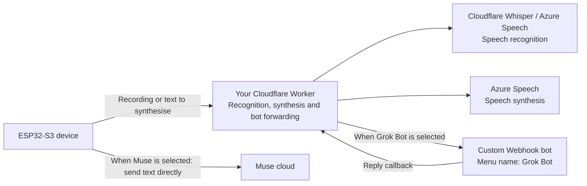

# muse-gadget-cloud

**English** · [中文](README.zh-CN.md)

This project extends Meta's [Muse Gadgets SDK](https://github.com/facebookincubator/muse-gadget-sdk) with speech services, bot integration and screen interactions for ESP32 devices. It currently supports the **Waveshare ESP32-S3-Touch-AMOLED-1.75C** round touch-screen board.

- **No self-hosted gateway required**. Deploy the gateway to your own Cloudflare account. Use Cloudflare Whisper or Azure Speech for recognition, and Azure Speech for synthesis.
- **Choose who answers**. Switch between Muse and a custom Webhook bot in the device's **Answers** menu. The menu calls the custom bot **Grok Bot**, but it does not have to use a Grok model.
- **Optional WireGuard connectivity**. When your network cannot reach Muse or the gateway directly, the built-in WireGuard client can connect through a Linux server you provide. That server must be able to reach the required services.
- **Round-screen interactions**. Blinking eyes that follow touch and tilt, custom picture avatars, a waiting ring, status information shown on touch, a `display.show_text` teleprompter, and spoken push messages from the main Muse chat. See the [firmware guide](docs/FIRMWARE.md) for the full feature list.

This is a personal project and has not been reviewed by Meta. Muse requires your own SDK token and use is subject to the [Gadget SDK Terms](https://gadgets.muse.ai). Voice and conversation data are sent to the cloud services you configure. When you choose a Webhook bot, the recognised text is also sent to that bot.

## How it works

The device sends recordings to the gateway for recognition, then sends the text to the selected answer source. With Muse selected, the text goes directly to Muse. With the Webhook bot selected, the gateway forwards the request and waits for a callback. Replies are synthesised through the gateway and played on the device.



WireGuard is an optional network path. It does not change the answer source or processing flow above.

## Before you start

| Item | Requirements |
|---|---|
| Board | Waveshare ESP32-S3-Touch-AMOLED-1.75C and a USB-C **data** cable |
| Muse | A Muse account and an [SDK token](https://gadgets.muse.ai) |
| Cloudflare | An account for deploying the gateway; you can start with the free plan |
| Azure | The key and region name of an [Azure Speech](https://portal.azure.com) resource, for example `eastasia`; Free F0 is an available pricing tier |
| Computer | macOS or Linux; Python 3.8+, Node.js, git and [ESP-IDF 6.0.1](https://docs.espressif.com/projects/esp-idf/en/v6.0.1/esp32s3/get-started/index.html) |
| Webhook bot | Optional. A bot that accepts an HTTPS Webhook and sends its reply back over HTTPS |
| WireGuard server | Optional. Only needed when Muse or Cloudflare cannot be reached directly; see the [server guide](docs/wireguard-server.md) |

To get a Muse token, sign in at [gadgets.muse.ai](https://gadgets.muse.ai) and accept the terms. The tool below handles Cloudflare login, KV creation and Worker deployment. After creating an Azure Speech resource, copy a key from **Keys and Endpoint**. Enter the region name, such as `eastasia`, in the configuration, not the endpoint URL. Provider pages and free allowances may change; check their official sites.

Install ESP-IDF **6.0.1** using Espressif's guide; other versions have not been verified. The tool expects it at `~/esp/esp-idf-v6.0.1`. If you install it elsewhere, update `idf_path` in the configuration.

## Quick start

```bash
git clone https://github.com/burndown/muse-gadget-cloud.git
cd muse-gadget-cloud
```

### 1. Create the configuration file

```bash
python3 tools/muse-cloud.py init
```

The tool copies `muse-cloud.example.toml` to `muse-cloud.toml`, sets its permissions to `600`, and generates two random tokens:

- **Device token**: allows the device to access the gateway and is written into the firmware.
- **Admin token**: allows gateway management and is not written into the device firmware.

`muse-cloud.toml` is in `.gitignore`. Do not commit or share it.

### 2. Fill in and check the configuration

Open `muse-cloud.toml` in a text editor and fill in these settings:

| Setting | Value |
|---|---|
| `[muse] sdk_token` | Your Muse SDK token |
| `[speech] azure_key`, `azure_region` | Your Azure Speech key and region name |
| `[speech] recognition` | `"cloudflare"` by default, with no separate recognition key; or `"azure"` |

For a custom bot, fill in the Webhook URL and credentials under `[bot]`. For WireGuard, set `[wireguard] enabled` to `true` and enter the server's address, port and public key. Keep the other settings at their template defaults.

```bash
python3 tools/muse-cloud.py check
```

Resolve any reported problems before continuing.

### 3. Deploy the gateway

```bash
python3 tools/muse-cloud.py gateway
```

The tool opens a browser for Cloudflare login, creates a KV store for settings, configures access tokens, deploys the Worker with Workers AI and Durable Object bindings, and uploads your Azure, bot and WireGuard settings. It prints the Worker URL and writes it to `muse-cloud.toml`. The command can be run again.

Open the admin page at `https://<your-worker>.workers.dev/admin?k=<admin-token>` to test the settings, or run `python3 tools/muse-cloud.py status` to check the gateway.

### 4. Build and flash the firmware

```bash
python3 tools/muse-cloud.py firmware --flash /dev/cu.usbmodem1101
```

Replace the serial port with your device's port. The tool fetches the pinned upstream source, applies the patch, generates build settings, then builds and flashes with ESP-IDF. Without `--flash`, it only builds. The first build downloads components; its duration depends on your network and computer.

If WireGuard is enabled and the device has no key yet, the tool generates a key pair and prints a server-side `wg set` command. Run it on the WireGuard server **before the device's first start**, and save the peer configuration in `wg0.conf` as instructed so it survives a server restart.

If esptool cannot connect, hold **BOOT**, tap **RST**, then release **BOOT** to enter download mode and try again. The first flash must write the bootloader, partition table and application together; the tool includes all three.

### Pair in the Muse app

1. After flashing, the device waits for pairing and advertises over Bluetooth as `MuseGadget-` followed by the last six hex digits of its Wi-Fi MAC address, for example `MuseGadget-4245C0`.
2. Add and select the device in the Muse app, then send its Wi-Fi name and password. The device connects to Wi-Fi and Muse.
3. If pairing fails or you need to pair again, follow the upstream firmware's instructions for holding the reset button. The log prompt is `long-press reset to pair again`.

Pairing has been tested on an existing board after erasing its entire flash, not on a new, out-of-the-box board.

## On the device

- **Hold to talk**. On release, the device recognises speech, sends the text to the selected answer source and plays the reply.
- **Swipe left or right** to open settings:
  - **Answers**: Muse / Grok Bot, with Muse selected by default. With Grok Bot selected, the device plays a Chinese acknowledgement before waiting for the reply. A timeout or connection failure shows an error; it does not switch to another answer source.
  - **WireGuard**: Off / Auto / Always. Off disables the tunnel; Auto starts it when Muse or the gateway cannot be reached directly; Always keeps it enabled.
  - **Avatar**: Eyes / Pixel Muse / Picture. Create a custom picture with `tools/make-avatar-img.py`, upload it using the admin token, then tap **Get picture** in the device settings.
- Status icons and button hints are hidden by default and appear when you touch the screen.

The gateway's fixed spoken prompts are currently in Chinese. The configuration template and command-line tool use English. See the [gateway guide](docs/GATEWAY.md) for changing the prompts.

## Connect a custom Webhook bot

The device menu calls this answer source **Grok Bot**. Any bot that implements the following callback protocol can be used; no particular model is required.

1. The gateway sends a `POST` to the configured Webhook URL with `Authorization: Bearer <credentials>` and a JSON body of `{"message": "<recognised text>\n\n(callback instructions…)"}`.
2. The bot copies the complete callback URL from the message and sends a `POST` to `https://<your-worker>.workers.dev/bot-reply/<id>/<one-time-token>`, with `{"reply": "<answer>"}` and `Content-Type: application/json`. No additional authorisation header is needed. The callback URL can be used once and expires after 10 minutes.
3. The gateway first makes the device play an acknowledgement, then holds the connection for up to 270 seconds. The device speaks the answer when it arrives, or reports a timeout if the bot does not reply.
4. If the bot restricts outbound requests, add the callback's Worker hostname to its allowlist. Otherwise the callback will be blocked.

The Webhook URL must use HTTPS and a public hostname. This flow has been tested with a real Webhook bot implemented as a Cursor automation. The repository does not include a stand-alone example bot server.

## Main configuration settings

| Section | Setting | Meaning |
|---|---|---|
| `[muse]` | `sdk_token` | Muse SDK token |
| `[gateway]` | `name` | Worker name |
| | `url`, `kv_id` | Filled in during deployment; `url` can also use a custom domain |
| | `device_token`, `admin_token` | Separate tokens generated by `init` |
| `[speech]` | `azure_key`, `azure_region`, `voice` | Azure Speech key, region and voice name |
| | `recognition`, `language` | Recognition service: `cloudflare` / `azure`; language code, such as `zh-CN` |
| `[bot]` | `webhook_url`, `auth` | Bot Webhook URL and credentials |
| | `callback_base` | Only needed when the bot must use a callback endpoint other than the default Worker URL |
| `[wireguard]` | `enabled`, `endpoint`, `port`, `server_public_key` | Whether to enable WireGuard, and the server connection details |
| | `address`, `subnet` | Device tunnel address and address prefix; use a different `address` for each device |
| | `mode`, `via_tunnel` | Default mode: `off` / `auto` / `always`; whether gateway requests also use the tunnel |
| | `private_key` | Device private key generated by the build tool when needed |
| `[firmware]` | `idf_path`, `upstream`, `upstream_commit`, `workdir` | ESP-IDF path, upstream repository, pinned commit and build directory |
| | `model_answers`, `home_ssid` | Keep the template defaults: `false` and an empty string |

## Troubleshooting

- **The device keeps restarting**: read the serial log at 115200 baud. `ESP_NETIF_BRIDGE_EN` must be enabled; the current firmware forces it on. If needed, remove the generated `build/` directory and rebuild. Do not keep your own source changes in that directory.
- **The device needs pairing again after a flash**: this can happen, especially if the previous firmware kept restarting. Pair again in the Muse app; rebuilding is not required.
- **Restoring a flash backup causes `HTTP 401`**: pairing again invalidates the old pairing tokens. Restoring an old NVS backup afterwards makes the device use those invalid tokens. Do not rely on an old flash backup to restore pairing.
- **The SDK token is invalid**: it must be 48 characters, start with `mgst_`, and end in one of `A E I M Q U Y c g k o s w 0 4 8`. Copy it again from [gadgets.muse.ai](https://gadgets.muse.ai), then run `check`.
- **Deployment fails with Cloudflare error 1010 or a connection error**: access to `workers.dev` can be intermittent on some networks. Run the deployment command again.
- **The bot never replies**: check the Webhook URL, credentials and whether the bot is allowed to reach the callback's Worker hostname.

## Costs and verification status

The gateway is intended for personal use. You can start with the Cloudflare free plan and Azure Speech F0. Whether you stay within the allowances depends on request volume, recorded audio duration and synthesised character count. See the [gateway guide](docs/GATEWAY.md) for limits and billing details. WireGuard server costs are separate.

The following status is summarised from existing test records dated 2026-10-21:

| Scenario | Status |
|---|---|
| Apply the patch to clean upstream `fa07304`, generate settings and build | Passed, including a build with WireGuard enabled |
| Tool commands `init`, `check`, `gateway`, `status`, `firmware` | Passed, including deployment to a real free Cloudflare account; the test Worker was deleted |
| Flash with the tool and complete a Muse voice interaction | Passed with Cloudflare Whisper recognition, Azure synthesis and WireGuard disabled |
| Erase the same board's entire flash, then build, flash, pair and interact from scratch | Passed; not tested on a new, out-of-the-box board |
| Use Grok Bot on the device after flashing with the tool | Not verified; the Worker-side bot flow has been tested |
| Enable WireGuard and use the tool-generated key on the device | Not verified |
| A user with no related experience follows only this guide from scratch | Not verified |
| Other boards / native Windows | Not adapted / not verified; Windows may require WSL |

See the [validation record](docs/VALIDATION.md) for measurements, the initial failure and its fix.

## Repository layout

| Path | Contents |
|---|---|
| `muse-cloud.example.toml` | Shared configuration template for the gateway and firmware |
| `tools/muse-cloud.py` | Configuration checks, gateway deployment, firmware builds and flashing |
| `worker/` | Cloudflare gateway: recognition, synthesis, bot forwarding, WireGuard enrolment, avatars and admin page |
| `firmware/muse-cloud.patch` | Firmware patch for upstream commit `fa07304` |
| `docs/` | [Gateway guide](docs/GATEWAY.md) · [Firmware guide](docs/FIRMWARE.md) · [WireGuard server setup](docs/wireguard-server.md) · [Validation record](docs/VALIDATION.md) |

The firmware and gateway share one repository so their interfaces and protocols can be maintained together. Use the pinned upstream commit, and keep the firmware patch and gateway code on the same repository version.

## Security and licensing

- `muse-cloud.toml` contains tokens, the Azure key and the WireGuard private key. Generated build settings and firmware also contain credentials. Do not commit, publish or share those files.
- The device token is written into the firmware and allows recognition, synthesis, chat, WireGuard enrolment and avatar downloads. Gateway management uses a separate admin token. Protect the full admin-page URL, which includes that token.
- Gateway and tool code is licensed under MIT; see [LICENSE](LICENSE).
- `firmware/muse-cloud.patch` modifies the upstream Muse Gadgets SDK and follows its [Apache-2.0](https://github.com/facebookincubator/muse-gadget-sdk/blob/main/LICENSE) licence. The 16×16 Chinese font data comes from [GNU Unifont](https://unifoundry.com/unifont/) 16.0.04 (GPLv2+ with the font-embedding exception, also OFL-1.1). The eyes' shapes and gestures are adapted from [zongzhu-bot](https://github.com/Liu-zhongxian/zongzhu-bot) (MIT). WireGuard uses [esphome/wireguard](https://components.espressif.com/components/esphome/wireguard) (BSD-3). The “All messages” feature is adapted from two commits of [wupsbr/waveshare-muse-gadget-sdk](https://github.com/wupsbr/waveshare-muse-gadget-sdk).
- “Muse”, “WireGuard” and other trademarks belong to their respective owners. Provider API integrations were informed by [xiaozhi-esp32-server](https://github.com/xinnan-tech/xiaozhi-esp32-server) (MIT).
