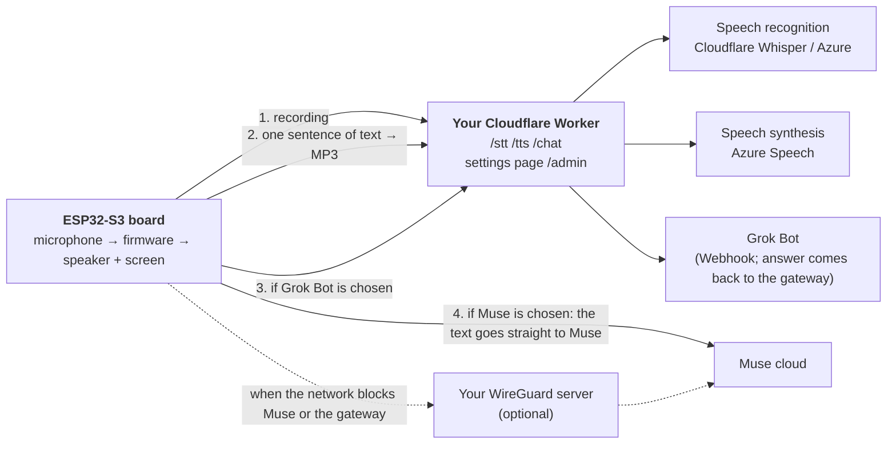

# muse-gadget-cloud

**English** · [中文](README.zh-CN.md)

Add-ons for Meta's [Muse Gadgets SDK](https://github.com/facebookincubator/muse-gadget-sdk) firmware on an ESP32 device (currently the **Waveshare ESP32-S3-Touch-AMOLED-1.75C** round touch screen). With it you get:

- **No server of your own.** Speech recognition and speech synthesis run on your own free Cloudflare and Azure accounts.
- **Several ways to answer.** Muse's own assistant, or a Webhook bot you connect (called the "Grok Bot" here). You switch between them in the device's settings.
- **Use it where Muse is blocked.** The device has a WireGuard client built in and connects to a server of yours only when it has to.
- Also in the firmware: an eyes avatar that blinks and follows your finger and the tilt of the board, a choice of avatars (including a picture of your own), a waiting ring, a clean main screen, a `display.show_text` teleprompter, and spoken push messages. The full list is in [docs/FIRMWARE.md](docs/FIRMWARE.md).

This is a personal project, not an official one, and Meta has not reviewed it. Using Muse needs your own SDK token and you must follow the [Gadget SDK Terms](https://gadgets.muse.ai). Your voice and conversations go to the cloud services you choose, which is different from using Muse's own cloud alone.

> **Languages.** This README and every page under `docs/` come in English and in Chinese (`*.zh-CN.md`). The settings file `muse-cloud.example.toml` and the tool `tools/muse-cloud.py` are in English. The sentences the gateway makes the device speak (for example the acknowledgement before the Grok Bot answers) are fixed Chinese strings in `worker/src/index.js`; see [docs/GATEWAY.md](docs/GATEWAY.md) if you use another language.

## What is in this repository

| Path | What it is |
|---|---|
| `muse-cloud.example.toml` | **One settings file** for the gateway and the firmware |
| `tools/muse-cloud.py` | Reads that file: one command deploys the gateway, one command builds (and flashes) the firmware |
| `worker/` | The **Cloudflare gateway** (cloud-only edition): recognition, synthesis, Grok Bot, WireGuard enrolment, the avatar picture, a settings page |
| `firmware/muse-cloud.patch` | A patch for the upstream Muse firmware, commit `fa07304` |
| `worker-home/`, `home/` | The other setup: a fuller gateway for a server at home (more cloud providers, local recognition, a language model). See [docs/HOME-SERVER.md](docs/HOME-SERVER.md) |
| `docs/` | [GATEWAY.md](docs/GATEWAY.md) gateway details · [FIRMWARE.md](docs/FIRMWARE.md) firmware features and manual build · [wireguard-server.md](docs/wireguard-server.md) setting up the WireGuard server · [HOME-SERVER.md](docs/HOME-SERVER.md) the home server edition |

**The firmware and the gateway are in one repository on purpose.** They are a pair. They share a set of conventions (a device token and an admin token, the `503` and the error marker that `/chat` returns, `/wg/enroll`, `/avatar`), and a change on one side needs a change on the other. In one repository a single commit keeps them compatible, so what you download always works together.



## Which setup do you want?

| | **Cloud-only** (this README) | **Home server** |
|---|---|---|
| Runs on | A free Cloudflare account | A server at home (the same code, run locally) |
| Needs | Cloudflare + Azure accounts | A server, and ideally a public address for use away from home |
| Recognition | Cloudflare Whisper (free) or Azure | More: Alibaba, Volcano Engine, a local SenseVoice |
| Language model | None | Yes (any OpenAI-compatible service) |
| Who can answer | Muse, Grok Bot | Muse, Grok Bot, the model |
| Setup effort | Four commands | Much more; see [docs/HOME-SERVER.md](docs/HOME-SERVER.md) |

If you are unsure, take the cloud-only setup.

## Before you start

| What | Details |
|---|---|
| The board | A Waveshare ESP32-S3-Touch-AMOLED-1.75C and a USB-C **data** cable (a charge-only cable will not work) |
| A Muse account and SDK token | The token comes from [gadgets.muse.ai](https://gadgets.muse.ai). It is 48 characters: `mgst_` followed by 43 more. See below |
| A Cloudflare account | Free. See below |
| An Azure Speech resource | The free F0 tier is enough. You need its **key** and **region**. See below |
| On your computer | macOS or Linux, Python 3.8 or newer, Node.js (the tool runs `npx wrangler`), git, and [ESP-IDF 6.0.1](https://docs.espressif.com/projects/esp-idf/en/v6.0.1/esp32s3/get-started/index.html) |
| A Grok Bot | **Optional.** A bot that accepts a Webhook and POSTs its answer back later. Without one, Answers offers only Muse. See below |
| A WireGuard server | **Optional.** Only needed if your network cannot reach Muse or Cloudflare. A Linux server abroad; see [docs/wireguard-server.md](docs/wireguard-server.md) |

I did not click through the sign-up pages of these services again while writing this, so the descriptions below are from what I know and may be out of date. Where it matters I say so.

### The Muse SDK token

Sign in at [gadgets.muse.ai](https://gadgets.muse.ai), accept the terms, and copy your token. The firmware build checks the token itself: it must be exactly 48 characters, start with `mgst_`, and end in one of the characters `A E I M Q U Y c g k o s w 0 4 8`. If you paste it wrong the build stops with "CONFIG_GADGET_SDK_TOKEN is not a valid SDK token". `tools/muse-cloud.py check` tells you the same before you build.

### The Cloudflare account

Create a free account at [dash.cloudflare.com](https://dash.cloudflare.com). You do not create anything by hand: `tools/muse-cloud.py gateway` logs in through your browser, creates a small KV store for the settings, and deploys the Worker. The Worker uses Workers AI (Whisper) and Durable Objects, both of which exist on the free plan; see [docs/GATEWAY.md](docs/GATEWAY.md) for the limits.

### The Azure Speech resource

In the [Azure portal](https://portal.azure.com) create a resource of type **Speech** (also listed as "Azure AI Speech" or under "AI Services"), choose the **Free F0** pricing tier, pick a region close to you (for example `eastasia`, `westeurope`, `eastus`), and after it is created open **Keys and Endpoint** to copy one key. Put the key and the region name (`eastasia`, not a URL) in `muse-cloud.toml`. The free tier covers about 5 hours of recognition and 500,000 characters of synthesis a month; check [Azure's pricing page](https://azure.microsoft.com/pricing/details/cognitive-services/speech-services) for the current numbers.

### ESP-IDF 6.0.1

Follow Espressif's [get started guide](https://docs.espressif.com/projects/esp-idf/en/v6.0.1/esp32s3/get-started/index.html) for the ESP32-S3 and install version **6.0.1** (other versions are not tested). The tool expects it at `~/esp/esp-idf-v6.0.1`; if yours is elsewhere, set `idf_path` in `muse-cloud.toml`.

### A Grok Bot (optional)

Any agent that can receive an HTTPS Webhook and make an HTTPS request will do. The contract is small:

1. The gateway sends `POST <your webhook address>` with `Authorization: Bearer <your auth>` and a JSON body `{"message": "<what you said>\n\n(instructions…)"}`. The instructions in the message tell the bot where to send the answer.
2. The bot answers by sending `POST https://<your-worker>.workers.dev/bot-reply/<id>/<one-time token>` with the body `{"reply": "<the answer>"}` and `Content-Type: application/json`. No other header or key is needed; the address works once and for 10 minutes. The bot copies the address from the message.
3. The gateway keeps the connection to the device open for up to 270 seconds and speaks the answer when it arrives. Before that it makes the device say "got it, asking" so you are not left in silence.
4. If the bot has a list of outside addresses it may call, add your `*.workers.dev` host to it. Otherwise the Webhook goes out but the answer is blocked, and the gateway waits the full 270 seconds and then says the bot did not answer.

I tested this with a real Webhook bot (a Cursor automation). I did not write or test a stand-alone example bot, so there is no sample server code here.

The Webhook address must be `https://` on a public host name; the gateway refuses anything else.

## Usage: four steps

```bash
git clone https://github.com/burndown/muse-gadget-cloud.git
cd muse-gadget-cloud
```

**Step 1: make the settings file**

```bash
python3 tools/muse-cloud.py init
```

This copies `muse-cloud.example.toml` to `muse-cloud.toml` (permissions 600; it is in `.gitignore`; **never commit it**) and generates two random tokens: a device token (it goes into the firmware) and an admin token (only for your browser).

**Step 2: fill in `muse-cloud.toml`**

Open it in a text editor. Every setting has an explanation above it. These are the ones you must fill in:

| Setting | What to put |
|---|---|
| `[muse] sdk_token` | Your Muse SDK token |
| `[speech] azure_key`, `azure_region` | Your Azure Speech key and region name |
| `[speech] recognition` | `"cloudflare"` (free, no key; the default) or `"azure"` |

Optional: `[bot]` takes the Grok Bot's Webhook address and auth; in `[wireguard]` set `enabled = true` and fill in the server's address, port and public key. Then run:

```bash
python3 tools/muse-cloud.py check        # tells you what is still missing
```

**Step 3: deploy the gateway**

```bash
python3 tools/muse-cloud.py gateway
```

It logs in to Cloudflare (a browser window opens), creates a KV store for the settings, sets the two tokens, deploys the Worker (with its Workers AI and Durable Object bindings) and pushes your Azure, bot and WireGuard settings into it. At the end it prints the Worker's address and writes it into `muse-cloud.toml`. You can run it again at any time; it is safe to repeat. `python3 tools/muse-cloud.py status` checks the gateway later.

The settings page is `https://<your-worker>.workers.dev/admin?k=<admin token>`. Every setting there has a **Test** button.

**Step 4: build and flash the firmware**

```bash
python3 tools/muse-cloud.py firmware --flash /dev/cu.usbmodem1101    # use your own serial port
```

It fetches the upstream firmware at the pinned commit, applies the patch, turns `muse-cloud.toml` into build settings, builds with ESP-IDF, and flashes. The first build downloads components and takes several minutes. If WireGuard is on and the device has no key yet, it makes a key pair for this device and prints **one command to run on the WireGuard server** (run it before the first start, and the device connects as soon as it boots).

Without `--flash` it only builds. If esptool cannot connect, put the board in download mode: hold BOOT, tap RST, release BOOT. The first flash writes the bootloader, partition table and application together (the tool does this), because the partition table has a new partition for the avatar picture.

### Pairing the device

1. After flashing, the screen waits for pairing and the board advertises over Bluetooth as `MuseGadget-` followed by the last six hex digits of its Wi-Fi MAC address (for example `MuseGadget-4245C0`).
2. In the Muse app, add the gadget, choose that device, and send it your Wi-Fi name and password. The device then joins Wi-Fi and connects to Muse.
3. If pairing does not start or you want to start over, the device's log says `long-press reset to pair again`; see the upstream firmware's documentation for the exact button on your board.
4. Pairing can be lost after a flash, especially if the previous firmware kept restarting. Pair again; you do not need to rebuild.

I wrote these steps from what I saw during my own tests. I have not done the first pairing of a brand-new out-of-the-box board, only of one whose flash I had erased.

## On the device

- **Hold to talk**, release, and the device recognises what you said, hands it to the answerer you chose, and speaks the reply.
- **Swipe left or right** to open the settings:
  - **Answers**: Muse, or Grok Bot (default Muse). With Muse, the text goes straight to Muse. With Grok Bot, the device first says "got it, I'll ask", then waits for the bot. If the bot does not answer or cannot be reached the screen shows an error. **No other answerer takes over.**
  - **WireGuard**: Off / Auto / Always. Auto starts the tunnel only when Muse or the gateway cannot be reached. If you set `[firmware] home_ssid` to your home Wi-Fi's name, Auto never starts it on that network.
  - **Avatar**: Eyes / Pixel Muse / Picture (a round picture of your own: make it with `tools/make-avatar-img.py` and upload it with the admin token, then tap Get picture in the settings).
- The main screen is clean. The status icons and button hints appear only when you touch the screen.

## All the settings in `muse-cloud.toml`

| Section | Setting | Meaning |
|---|---|---|
| `[muse]` | `sdk_token` | Your Muse SDK token |
| `[gateway]` | `name` | The Worker's name; its address becomes `https://<name>.<account>.workers.dev` |
| | `url` | Filled in by the gateway step; or your own domain |
| | `device_token`, `admin_token` | Two different random strings; `init` makes them |
| | `kv_id` | Filled in by the gateway step |
| `[speech]` | `azure_key`, `azure_region`, `voice` | Azure Speech key, region name, and the voice (any Azure neural voice name) |
| | `recognition`, `language` | `cloudflare` or `azure`; the language code, for example `zh-CN`, `en-US` |
| `[bot]` | `webhook_url`, `auth`, `callback_base` | The bot's Webhook address (https) and secret; `callback_base` only if the bot must call a different address than your Worker's |
| `[wireguard]` | `enabled`, `endpoint`, `port`, `server_public_key`, `address`, `subnet` | The tunnel; one `address` per device |
| | `mode`, `via_tunnel` | `off`/`auto`/`always`; whether speech and chat also use the tunnel |
| | `private_key` | Made by the firmware step |
| `[firmware]` | `idf_path`, `upstream`, `upstream_commit`, `workdir` | Where ESP-IDF is; the upstream firmware and its pinned commit; the folder for sources and the build |
| | `model_answers` | Keep `false` for the cloud-only setup |
| | `home_ssid` | Your home Wi-Fi's name, if you also run a home server; empty otherwise |

## When something goes wrong

- **The device keeps restarting.** Read the serial log (115200 baud). If you edited the build settings, make sure you did not turn off `ESP_NETIF_BRIDGE_EN` (the firmware now forces it on). Deleting the `build/` folder and running `firmware` again is safe.
- **The device needs pairing again after a flash.** It happens, especially after a firmware that kept restarting. Pair again in the Muse app.
- **Do not restore a saved flash backup to get pairing back.** Pairing again makes Muse invalidate the old tokens. If you restore a backup of the NVS partition after a new pairing, the device is refused by Muse (`HTTP 401` in the log) and clears its pairing. A backup helps for Wi-Fi and menu settings, not for pairing.
- **`firmware` says the SDK token is invalid.** See the token format above; copy it again from [gadgets.muse.ai](https://gadgets.muse.ai).
- **`gateway` fails with Cloudflare error 1010, or cannot connect.** From some networks `workers.dev` is reachable only some of the time. Run the command again.
- **The Grok Bot always says it did not answer.** Your `*.workers.dev` host is not in the bot's list of outside addresses it may call.

## Costs and free allowances

The cloud-only setup is designed for free accounts, but check the current numbers yourself (details in [docs/GATEWAY.md](docs/GATEWAY.md)): Cloudflare Workers free plan allows 100,000 requests a day; Workers AI Whisper allows about 200 minutes of audio a day; Azure Speech's free tier allows about 5 hours of recognition and 500,000 characters of synthesis a month. For one person this is far more than enough. If you share the project, each person should deploy their own copy.

## Security

- `muse-cloud.toml` holds tokens, the Azure key and the WireGuard private key. **Never commit it or send it to anyone.** The build settings the tool writes under `build/` and the firmware it builds also contain the device token; do not upload those either.
- The device token is written into the firmware, so whoever has the device has it. That is why it can only be used for recognition, synthesis, chat, enrolment and downloading the picture. Managing the gateway (the settings page, keys, approving WireGuard devices) accepts only the admin token.
- Tokens must be long random strings; the ones `init` generates are.

## What has been verified (honestly)

| What | Status |
|---|---|
| The patch applied to a clean upstream `fa07304`, build settings generated from `muse-cloud.toml`, built from scratch; the firmware contains the patch's features and the new partition | Passed (2026-10-21, including with WireGuard on) |
| `tools/muse-cloud.py` `init`, `check`, `gateway` (a real deployment to a free Cloudflare account), `status`, `firmware` | Passed (the test Worker was deleted afterwards) |
| `firmware --flash` onto a real device, then a full Muse turn (recognition with Cloudflare Whisper, synthesis with Azure, both through your own Worker): 20 pieces of speech fetched, 55 s of speech, 135 s in all, lowest free internal memory 12 KB | Passed (2026-10-21, `wireguard.enabled = false`). **The first attempt failed**: the tool had left out `CONFIG_ESP_NETIF_BRIDGE_EN`, the device restarted every 4 seconds and lost its pairing. Fixed (the firmware now requires that option itself); the second attempt passed |
| A board whose flash was **erased completely**, then built and flashed from scratch by the tool and paired: one full turn worked (39 s, no restart) | Passed (2026-10-21, on the same Waveshare 1.75C). **Not done on a truly new, out-of-the-box board** |
| The gateway, WireGuard and the answerers (Muse, Grok Bot; the model on the home server) on the device | Passed; details in [docs/GATEWAY.md](docs/GATEWAY.md) and [docs/FIRMWARE.md](docs/FIRMWARE.md) |
| A person with no background following only this document from scratch | **Not verified** |
| Grok Bot answering through the device after a flash by the tool | Not verified (tested through the Worker, and on the device with the home-server build) |
| Flashing with WireGuard on, using the tool's generated key | Not verified on a device |
| Other boards | Not adapted |
| Windows (the tool calls ESP-IDF's `export.sh` through `bash`) | Not verified; probably needs WSL |

## Licence and thanks

- `worker/`, `worker-home/` and `tools/` are under the MIT licence (see [LICENSE](LICENSE)).
- `firmware/muse-cloud.patch` is a modification of the upstream Muse Gadgets SDK and follows the upstream [Apache-2.0](https://github.com/facebookincubator/muse-gadget-sdk/blob/main/LICENSE) licence. The 16×16 Chinese font data in it comes from [GNU Unifont](https://unifoundry.com/unifont/) 16.0.04 (GPLv2+ with the font-embedding exception, also OFL-1.1). The eyes' shapes and gestures are adapted from [zongzhu-bot](https://github.com/Liu-zhongxian/zongzhu-bot) (MIT). WireGuard uses [esphome/wireguard](https://components.espressif.com/components/esphome/wireguard) (BSD-3). "All messages" is adapted from two commits of [wupsbr/waveshare-muse-gadget-sdk](https://github.com/wupsbr/waveshare-muse-gadget-sdk).
- "Muse" and "WireGuard" are trademarks of their owners. The providers' API usage was informed by [xiaozhi-esp32-server](https://github.com/xinnan-tech/xiaozhi-esp32-server) (MIT).
