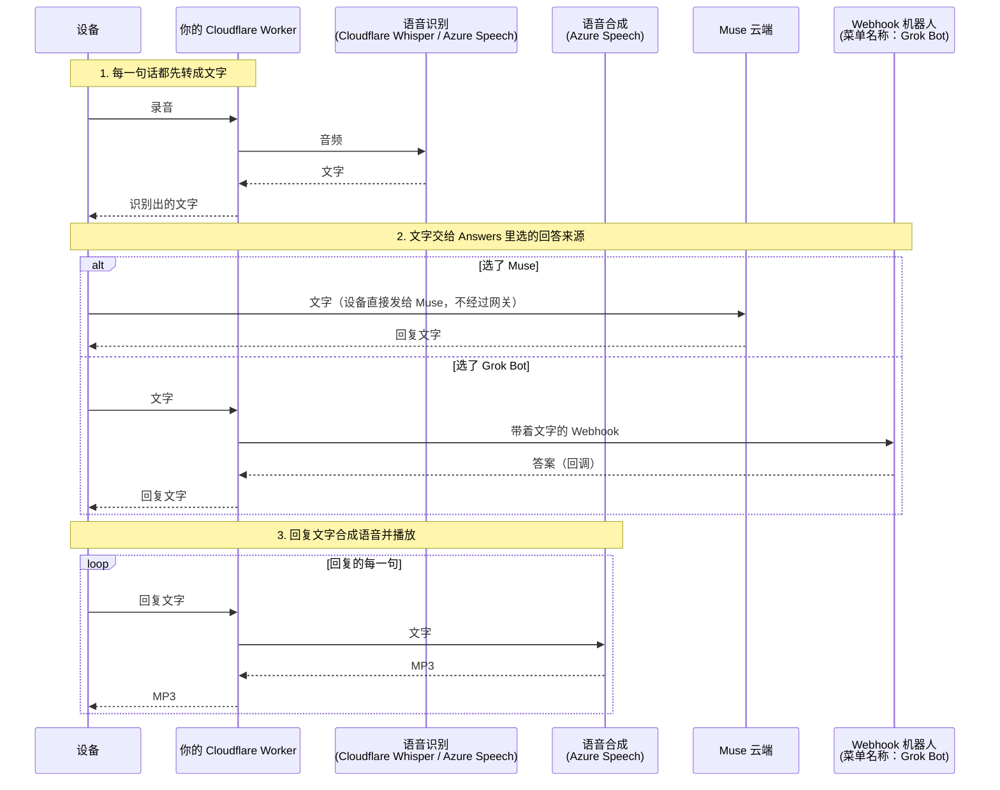
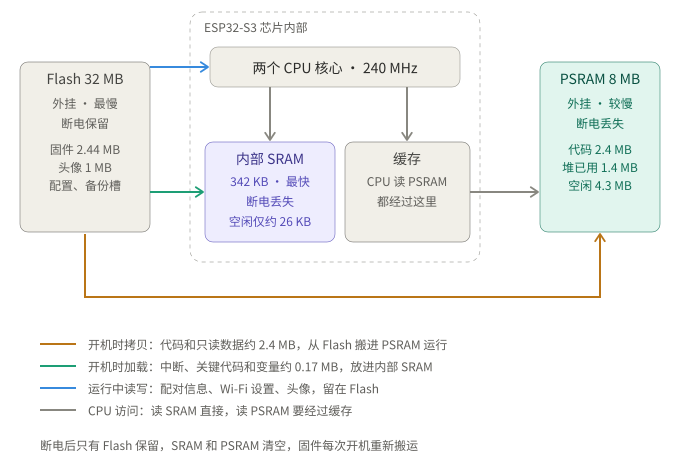
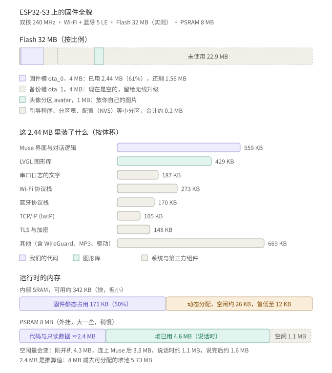

# ESP32 TwinMate

**给你的 ESP32 小设备配上两个 AI 伙伴。Muse 和 Grok Bot 随心切换，语音播报，在家出门都在线。**

[English](README.en.md) · **中文**

<p align="center"></p>

本项目是 Meta [Muse Gadgets SDK](https://github.com/facebookincubator/muse-gadget-sdk) 固件的魔改版，目前只支持**微雪 ESP32-S3-Touch-AMOLED-1.75C** 。但是我猜移植到其他 ESP32 也不难。本项目在原有基础上增加：

- **先转文字，再交给回答者**：你说的话先识别成文字（Cloudflare Whisper 或 Azure Speech，可选），再交给 Muse 或 Grok bot。我在使用的时候经常发现Muse 转译出现问题，有时候甚至会卡住，莫不如我们自己先转了，发给Muse，Azure正常的免费额度足够轻量使用了。
- **Grok Bot**：在设备的 **Answers** 菜单里切换 Muse 和 Grok Bot。
- **语音播报**：回复由 Azure Speech 合成语音，在设备上播放。个人使用通常在免费额度内，具体以服务商当前的条款为准。
- **Muse 把文字发到屏幕上**：原版固件里 Muse 只能发图片。本项目还支持接收文字：`display.show_text` 命令把文字显示成滚动的提词器并可朗读，Muse 主动发来的消息也可以被念出来（“所有消息”）。
- **WireGuard（可选）**：所在网络无法直连 Muse 时，设备通过你自己的 Linux 服务器隧道连接。适合不在家无法分流，使用公共Wi-Fi或者手机热点的时候使用。
- **Cloudflare 网关**：一个管理网关，管理上边提到的语音转换/播报，Grok bot 参数，以及 WireGuard。推荐部署在 Cloudflare 上，免费额度够用。
- **头像与交互**：可更换的头像（包括你自己的图片），和全屏的 Badge 图片。图片在网关的管理页上传，上传前可以在圆形预览里拖动、缩放、旋转，设备上点一下同步；每台设备各有一套。
- **一个配置文件、三条命令**：即可部署网关、编译并刷写固件。全部功能（包括稳定性修复）见 [固件说明](docs/FIRMWARE.zh-CN.md)。


## 免责声明

本项目建立在他人工作的基础上：Meta 的固件（Apache-2.0）、改编自 [zongzhu-bot](https://github.com/Liu-zhongxian/zongzhu-bot)（MIT）的眼睛，以及改编自 [wupsbr/waveshare-muse-gadget-sdk](https://github.com/wupsbr/waveshare-muse-gadget-sdk) 的“所有消息”。详见文末的“安全与许可”。

这是个人项目，未经 Meta 审核。使用 Muse 需要你自己的 SDK token，并遵守 [Gadget SDK Terms](https://gadgets.muse.ai)。语音和对话内容会发送到你配置的云服务；选择 Webhook 机器人时，识别出的文字也会发送给该机器人。

## 工作方式

一个简短的工作流程：

每一句话都先转成文字，设备把录音交给Azure（或者Cloudflare，下文就只写一个）识别，Azure把文字返回给设备。设备再把这段文字交给设备里设置页面**Answers** 里选定的回答来源：选 Muse 时，设备直接把文字发给 Muse；选 Grok bot时，文字经网关转给Grok bot，Grok Bot 通过回调把答案送回Cloudflare网关,再由 Cloudflare 网关送去 Azure 一句一句合成语音，在设备上播放。

流程图：



WireGuard 是在网络不可达时的备选通道，不改变上述回答来源或处理流程。

## 开始前准备

| 项目 | 要求 |
|---|---|
| 开发板 | Waveshare ESP32-S3-Touch-AMOLED-1.75C，以及一根 USB-C **数据线** |
| Muse/Grok bot | Muse 账号及 [SDK token](https://gadgets.muse.ai) / Grok Bot 账号 |
| Cloudflare | 用于部署网关的账号，可从免费方案开始 |
| Azure | 一个 [Azure Speech](https://portal.azure.com) 资源的密钥和区域名，例如 `eastasia`；可选择 Free F0 定价层 |
| 电脑 | macOS 或 Linux；Python 3.8+、Node.js、git、[ESP-IDF 6.0.1](https://docs.espressif.com/projects/esp-idf/en/v6.0.1/esp32s3/get-started/index.html) |
| WireGuard 服务器 | 可选。仅在无法直连 Muse 或 Cloudflare 时需要，配置见 [服务器说明](docs/wireguard-server.zh-CN.md) |

备注：

- Muse token 在 [gadgets.muse.ai](https://gadgets.muse.ai) 登录并接受条款后获取。
- Grok bot 的调用方式可以让 Grok bot 直接帮你生成
- Cloudflare 的登录、KV 创建和 Worker 部署由下文脚本完成。
- Azure Speech 资源创建后，在 **Keys and Endpoint** 中复制密钥；配置中填写区域名，如 `eastasia`，不要填写端点网址。各平台页面和免费额度可能调整，请以官方网站为准。
- ESP-IDF 请按乐鑫入门指南安装 **6.0.1** 版，其他版本尚未验证。脚本默认路径为 `~/esp/esp-idf-v6.0.1`，安装在其他位置时修改配置中的 `idf_path`。


## 快速开始

```bash
git clone https://github.com/burndown/esp32-twinmate.git
cd esp32-twinmate
```

### 1. 生成配置文件

```bash
python3 tools/muse-cloud.py init
```

脚本将 `muse-cloud.example.toml` 复制为 `muse-cloud.toml`，设置文件权限为 `600`，并生成两个随机令牌：

- **设备令牌**：用于设备访问网关，会写入固件。
- **管理令牌**：用于管理网关，不写入设备固件。

`muse-cloud.toml` 已加入 `.gitignore`，不要提交或分享。

### 2. 填写配置并检查

用文本编辑器打开 `muse-cloud.toml`，填写以下配置：

| 配置项 | 内容 |
|---|---|
| `[muse] sdk_token` | 你的 Muse SDK token |
| `[bot] webhook_url` | 你的Grok bot webhook url |
| `[bot] auth` | 你的Grok bot auth，以`crsr_` 开头 |
| `[speech] azure_key`、`azure_region` | Azure Speech 密钥和区域名 |
| `[speech] recognition` | 默认 `"cloudflare"`，无需另填识别密钥；也可选择 `"azure"` |
| `[gateway] name` | 给这个Cloudflare 网关起个名字 |

如需 WireGuard，将 `[wireguard] enabled` 设为 `true`，填写服务器地址、端口和公钥。其他配置保留模板默认值。

```bash
python3 tools/muse-cloud.py check
```

检查通过后继续。

### 3. 部署网关

```bash
python3 tools/muse-cloud.py gateway
```

脚本会打开浏览器登录 Cloudflare，创建用于保存设置的 KV，配置访问令牌，部署带 Workers AI 和 Durable Object 绑定的 Worker，再上传 Azure、机器人和 WireGuard 设置。完成后会打印 Worker 地址，并写入 `muse-cloud.toml`。该命令可重复运行。`[gateway] url` 请留空：脚本会按 Cloudflare 返回的地址填写，并且以它为准，手填的值会被覆盖。

**在没有浏览器的机器上**（例如远程服务器），`wrangler login` 无法使用，改用 Cloudflare API 令牌：

1. 在 Cloudflare 控制台打开 My Profile > API Tokens，创建一个令牌，权限为 **Workers Scripts: Edit**、**Workers KV Storage: Edit** 和 **Account Settings: Read**。如果设置了 *Client IP Address Filtering*，里面必须包含这台机器在 Cloudflare 看到的地址（用 `curl https://www.cloudflare.com/cdn-cgi/trace` 查看），否则 Cloudflare 会返回错误 9109。
2. 令牌请自己在终端里输入，避免留在命令历史或聊天记录里：

```bash
read -s CLOUDFLARE_API_TOKEN; export CLOUDFLARE_API_TOKEN
export CLOUDFLARE_ACCOUNT_ID=<32 位账户 ID>
```

账户 ID 是控制台地址 `dash.cloudflare.com/<账户 ID>/...` 里那串 32 位字符，Workers & Pages 概览页上也有。它不是账户名，也不是登录邮箱。设置了令牌后，脚本会跳过登录。

管理页面：`https://<你的worker>.workers.dev/admin?k=<管理令牌>`。可在页面中测试各项配置，或运行 `python3 tools/muse-cloud.py status` 检查网关状态。这里也可以对各项配置再做一次更改。

### 4. 编译并刷写固件

先查看串口并记下来：

```bash
python3 tools/muse-cloud.py ports
```

它会列出找到的串口（macOS 是 `/dev/cu.usbmodem*`，Linux 是 `/dev/serial/by-id/*` 和 `/dev/ttyACM*`）。在 Linux 上，如果你的账号没有权限打开串口，它会在同一行提示：把自己加入 `dialout` 组（`sudo usermod -aG dialout $USER`），重新登录后生效。如果什么都没列出，请换一根能传数据的 USB 线。`by-id` 名称在接入其他板子时不会变化，Linux 上优先使用它。

```bash
python3 tools/muse-cloud.py firmware --flash /dev/cu.usbmodem1101
```

将串口路径替换为刚才记下的路径。如果该串口不存在，脚本会在漫长的编译开始之前就停下。脚本会获取指定版本的上游源码、应用补丁、生成编译配置，然后通过 ESP-IDF 编译并刷写固件。不加 `--flash` 时只编译。首次编译需要下载组件，耗时取决于网络和电脑性能。

> [!IMPORTANT]
>
> 如果配置文件里 WireGuard 段落设置为 True，脚本会在尚无设备密钥时生成密钥对，并打印服务器端的 `wg set` 命令。**在设备首次启动前**，先在 WireGuard 服务器上执行该命令，并按提示将设备配置保存到 `wg0.conf`，以便服务器重启后仍然有效。
>

若 esptool 无法连接，按住 **BOOT**、按一下 **RST**，再松开 **BOOT**，进入下载模式后重新执行命令。首次刷写需要同时写入引导程序、分区表和应用，脚本已包含这些操作。

### 在 Muse App 中配对

1. 刷写完成后，设备等待配对，并通过蓝牙广播 `MuseGadget-` 加 Wi-Fi MAC 地址后六位的名称，例如 `MuseGadget-4245C0`。
2. 在 Muse App 中添加并选中该设备，发送 Wi-Fi 名称和密码。设备随后连接 Wi-Fi 和 Muse。
3. 如果无法配对或需要重新配对，按上游固件文档中的方法长按复位键；日志提示为 `long-press reset to pair again`。

配对流程已在擦除全部闪存的现有开发板上验证，尚未在全新出厂的开发板上验证。


## 在设备上使用

- **按住说话**，松开后设备识别语音，将文字交给选定的回答来源，再播放回复。
- **左右滑动圆屏**进入设置：
  - **Answers**：Muse / Grok Bot，默认 Muse。选择 Grok Bot 后，设备先播放“收到，我去问小黑，请稍等。”，再等待回复。超时或连接失败时显示错误，不会自动切换回答来源。
  - **WireGuard**：Off / Auto / Always。Off 关闭隧道；Auto 在无法直连 Muse 或网关时启动隧道；Always 始终使用隧道。
  - **Avatar**：Eyes / Pixel Muse / Picture。图片在网关管理页上传，在设备上点击 **Get picture** 取回，并选成 **Picture**；也可以用 `tools/make-avatar-img.py` 制作。
  - **Badge**：全屏图片，点一下换下一张；点 **Sync with gateway** 或在图片上按住约一秒半，从网关复制图片。需要带 badge 分区的固件。
- 主屏默认隐藏状态图标和按键提示，触摸屏幕后显示。

网关的固定提示语目前为中文，配置文件和命令行工具使用英文。修改提示语的方法见 [网关说明](docs/GATEWAY.zh-CN.md)。


## 用管理页上传头像和 Badge 图片

打开管理页（`https://<你的网关>/admin?k=<管理令牌>`）的“外观”页签：

1. **先选设备。** 头像和 Badge 图片按设备分开保存：设备取图时用 `d=<节点编号>`（例如圆圆是 `homelink-4245c0`）报上自己的名字，第一次来就会出现在下拉列表里，默认名字是 `Device` 加编号后六位，可以改名或删除。没带编号的旧固件取的是“旧的单套数据”；加这个功能之前上传的图片就在那里，有一个按钮可以把它复制给某台设备。
2. **选图片，在圆形预览里编辑。** 拖动调整位置，滑块或滚轮缩放（缩到 1 以下会补黑边），可以旋转和重置，还能勾选“叠加时间”，看表盘的字压在图上的样子。预览就是上传的内容：浏览器把它裁成 233×233（头像）或 466×466（Badge），涂黑圆屏外的四角，转成设备用的格式再上传，图片不经过任何第三方。
3. **到设备上取回。** 头像：设置 → Avatar → **Get picture**，等它显示 Done，并且头像要选成 **Picture**（选 Eyes 或 Pixel Muse 时不会显示图片）。Badge：设置 → Badge → **Sync with gateway**，或在图片上按住约一秒半。同步只复制版本变了的图片，网关上删掉的图片在下次同步后也会从设备上消失。

Badge 页需要带 badge 分区的固件（`partitions_muse_badge.csv`，4 MB，最多 9 张）。要用公网地址同步，网关前面的转发必须放行 `GET /badge/list` 和 `GET /badge/<编号>`；管理页本身是按管理令牌保护的。

## 接入自定义 Webhook 机器人（Grok Bot）

设备菜单将这一回答来源称为 **Grok Bot**。任何符合以下回调协议的机器人都可接入，不要求使用特定模型。

1. 网关向配置的 Webhook 地址发送 `POST`，请求头为 `Authorization: Bearer <授权凭据>`，JSON 请求体为 `{"message": "<识别出的文字>\n\n（回调说明……）"}`。
2. 机器人从消息中复制完整回调地址，向 `https://<你的worker>.workers.dev/bot-reply/<id>/<一次性令牌>` 发送 `POST`。请求体为 `{"reply": "<答案>"}`，并设置 `Content-Type: application/json`。无需额外的授权请求头；回调地址仅可使用一次，有效期为 10 分钟。
3. 网关先让设备播放确认提示，再保持连接等待答案，最长 270 秒。收到答案后由设备播放；超时则报告机器人未回复。
4. 如果机器人限制可访问的外部地址，需将回调地址中的 Worker 域名加入允许列表，否则回调会被拦截。

Grok Bot 一次提问如何使用 KV 和 Durable Object，见 [技术细节](docs/GROK-BOT.zh-CN.md)。

Webhook 地址必须使用 HTTPS，且主机名为公网域名。该流程已通过真实 Webhook 机器人（Cursor 自动化）验证，仓库未提供独立的示例机器人服务器。


## 主要配置项

| 配置段 | 配置项 | 说明 |
|---|---|---|
| `[muse]` | `sdk_token` | Muse SDK token |
| `[gateway]` | `name` | Worker 名称 |
| | `url`、`kv_id` | 部署时由脚本自动填写；`url` 也可填写自定义域名 |
| | `device_token`、`admin_token` | `init` 生成的两个独立令牌 |
| `[speech]` | `azure_key`、`azure_region`、`voice` | Azure Speech 密钥、区域和音色名称 |
| | `recognition`、`language` | 识别服务 `cloudflare` / `azure`；语言代码，如 `zh-CN` |
| `[bot]` | `webhook_url`、`auth` | 机器人 Webhook 地址和授权凭据 |
| | `callback_base` | 仅在机器人需要使用不同于 Worker 默认地址的回调入口时填写 |
| `[wireguard]` | `enabled`、`endpoint`、`port`、`server_public_key` | 是否启用及服务器连接信息 |
| | `address`、`subnet` | 设备隧道地址和地址前缀；每台设备使用不同的 `address` |
| | `mode`、`via_tunnel` | 默认模式 `off` / `auto` / `always`；网关请求是否也通过隧道 |
| | `private_key` | 编译脚本在需要时生成的设备私钥 |
| `[firmware]` | `idf_path`、`upstream`、`upstream_commit`、`workdir` | ESP-IDF 路径、上游仓库、固定提交和构建目录 |
| | `model_answers`、`home_ssid` | 保持模板默认值：`false` 和空字符串 |


## 固件与存储空间

ESP32-S3 有三种存储：外挂的 **Flash**（断电保留，最慢）、芯片内部的 **SRAM**（最快，但小）和外挂的 **PSRAM**（大一些，稍慢）。固件平时放在 Flash 里；开机时代码和只读数据被拷进 PSRAM 运行，只有中断和关键代码留在 SRAM。下图是它们之间的关系：

<p align="center"></p>

下图是固件现在占用的空间：Flash 的分区、2.44 MB 固件里各部分的体积，以及运行时 SRAM 和 PSRAM 的使用情况。

<p align="center"></p>

数据来自 2026-10-22 的一次编译（合并上游 e6fe517 之后）和圆圆的串口日志，不同版本会有小幅出入。Flash 的容量是用 esptool 在板子上读出的 32 MB（官方标称 16 MB），分区表只用了前 9 MB 左右。PSRAM 里代码和只读数据的 2.4 MB 是推算值。最紧张的是内部 SRAM：运行时空闲只有约 26 KB，所以语音缓冲这类大块内存要放在 PSRAM。

## 常见问题

- **设备反复重启**：查看串口日志（115200 波特率）。编译配置必须启用 `ESP_NETIF_BRIDGE_EN`，当前固件已强制启用。必要时清理生成的 `build/` 目录后重新编译；不要在此目录中保存自己的源码修改。
- **刷写后需要重新配对**：尤其在旧固件曾反复重启时可能发生。在 Muse App 中重新配对即可，无需重新编译。
- **恢复闪存备份后出现 `HTTP 401`**：重新配对会使旧配对令牌失效。之后再恢复旧 NVS 备份，设备会使用失效令牌并被 Muse 拒绝。不要依靠旧闪存备份恢复配对。
- **SDK token 无效**：token 必须为 48 个字符，以 `mgst_` 开头，最后一个字符为 `A E I M Q U Y c g k o s w 0 4 8` 之一。请从 [gadgets.muse.ai](https://gadgets.muse.ai) 重新复制，并运行 `check`。
- **部署时报 Cloudflare 1010 或无法连接**：部分网络访问 `workers.dev` 不稳定，可重新运行部署命令。
- **`check` 通过，但 `gateway` 马上失败**：看报错信息。`[gateway] name` 为空、账户 ID 填错是最常见的原因。
- **Cloudflare 错误 9109 “Cannot use the access token from location”**：API 令牌设置了 IP 地址限制，其中不含这台机器。把 `curl https://www.cloudflare.com/cdn-cgi/trace` 显示的地址加进去，或取消该限制。
- **按住说话键超过 10 秒，板子断电重启**：这块板子上说话键就是 PWR 键，它直接接在电源管理芯片上，按住满 10 秒芯片会硬件断电，固件拦不住。请在 10 秒内松手。（固件可以在 9 秒时自动结束这次说话，我们在自己的构建里做了，本仓库的补丁暂时还没有。）
- **管理页上传了，设备里没变**：先看管理页“外观”页签顶部选的是不是这台设备（不要选“旧的单套数据”，除非设备是没有编号的旧固件）。头像要在设备上点 **Get picture**，并且选成 **Picture**；Badge 要点 **Sync with gateway**，不会自动更新。
- **出门时 Badge 同步失败**：设备走的是网关的公网地址，网关前面的转发必须放行 `GET /badge/list` 和 `GET /badge/<编号>`，否则会得到 404。
- **机器人一直未回复**：先检查 Webhook 地址、授权凭据，以及机器人是否获准访问回调所用的 Worker 域名。


## 费用与验证状态

网关面向个人使用，可从 Cloudflare 免费方案和 Azure Speech F0 开始。是否超出免费额度取决于请求量、录音时长和合成字符数；当前限额及计费说明见 [网关文档](docs/GATEWAY.zh-CN.md)。WireGuard 服务器费用另计。

以下状态整理自已有的 2026-10-21 测试记录：

| 场景 | 状态 |
|---|---|
| 在干净的上游 `e6fe517` 上应用补丁并用脚本编译（含 Badge、设备编号、蓝牙按需等） | 已通过（只编译，没有刷机） |
| 在干净的上游 `fa07304` 上应用补丁，从配置生成设置并编译 | 已通过，包含启用 WireGuard 的编译组合 |
| 脚本 `init`、`check`、`gateway`、`status`、`firmware` | 已通过，包含真实 Cloudflare 免费账号部署；测试 Worker 已删除 |
| 使用脚本刷写后，完成 Muse 语音交互 | 已通过，识别使用 Cloudflare Whisper，合成使用 Azure，WireGuard 关闭 |
| 同一块开发板擦除全部闪存后，从零编译、刷写、配对及交互 | 已通过；尚未在全新出厂开发板上验证 |
| 管理页上传头像和 Badge 图片（浏览器裁剪、转换、上传到所选设备） | 已通过：真实浏览器的自动化测试，以及圆圆上的实际取图 |
| 设备在家里局域网内从网关同步 Badge、取头像 | 已通过：圆圆上 434 KB 的一张图用时约 1.4 秒，无崩溃 |
| 出门用公网地址同步 Badge | 尚未验证；转发已放行 GET，用命令行测试通过 |
| 管理页里用鼠标拖动编辑 | 尚未验证：缩放、移动、旋转用脚本驱动测试过，没有人手动拖过 |
| 多设备：两台设备各自一套头像和图片 | 网关侧已通过（38 项模拟测试）；圆圆和另一块板子都已登记，另一块板子的图片同步尚未验证 |
| 通过脚本刷写后，在设备上使用 Grok Bot | 尚未验证；已验证 Worker 端的机器人通路（用真实 Webhook 机器人，Cursor 自动化） |
| 启用 WireGuard，并在设备上使用脚本生成的密钥 | 尚未验证 |
| 无相关经验的使用者仅按本文从零操作 | 尚未验证 |
| 其他开发板 / Windows 原生环境 | 未适配 / 尚未验证；Windows 可能需要 WSL |

测试数据、首次失败原因及修复经过见 [验证记录](docs/VALIDATION.zh-CN.md)。

## 这个仓库里的固件补丁停在哪里

`firmware/muse-cloud.patch` 现在针对上游 `e6fe517`，包含：Badge 页和从网关同步图片、设备编号（`d=`）、头像取回后立即刷新和铺满整屏（`CONFIG_MUSE_PHOTO_FILL`，载入时放大一次）、蓝牙按需启动（`CONFIG_MUSE_BLE_ON_DEMAND`）、说话键按住 9 秒自动结束（1.75C 的说话键是 PWR 键，电源芯片按住 10 秒会硬件断电）和省内部 RAM 的配置。它在干净的上游上应用并编译通过（不含刷机验证）；这些功能的运行验证来自作者设备上同一份代码的构建。时钟、计时器等 StopWatch 专用页面不在补丁里。

## 仓库结构

| 路径 | 内容 |
|---|---|
| `muse-cloud.example.toml` | 网关和固件的统一配置模板 |
| `tools/muse-cloud.py` | 配置检查、网关部署、固件编译与刷写工具 |
| `worker/` | Cloudflare 网关：语音识别、合成、机器人转发、WireGuard 登记、头像和管理页面 |
| `firmware/muse-cloud.patch` | 针对上游提交 `e6fe517` 的固件补丁 |
| `docs/` | [网关说明](docs/GATEWAY.zh-CN.md) · [固件说明](docs/FIRMWARE.zh-CN.md) · [WireGuard 服务器配置](docs/wireguard-server.zh-CN.md) · [验证记录](docs/VALIDATION.zh-CN.md) |

固件和网关放在同一仓库中，便于同步维护接口和协议。编译时请使用仓库指定的上游提交，并配套使用同一版本的固件补丁和网关代码。

## 安全与许可

- `muse-cloud.toml` 包含令牌、Azure 密钥和 WireGuard 私钥；生成的编译配置和固件也包含凭据。不要提交、公开或分享这些文件。
- 设备令牌写入固件，用于识别、合成、对话、WireGuard 登记和头像下载。网关管理使用独立的管理令牌。访问管理页面时，也应保护包含令牌的完整网址。
- 网关和工具代码采用 MIT 许可，见 [LICENSE](LICENSE)。
- `firmware/muse-cloud.patch` 是对上游 Muse Gadgets SDK 的修改，遵循上游 [Apache-2.0](https://github.com/facebookincubator/muse-gadget-sdk/blob/main/LICENSE)。16×16 中文字库数据来自 [GNU Unifont](https://unifoundry.com/unifont/) 16.0.04（GPLv2+ 带字体嵌入例外，另有 OFL-1.1 双许可）；眼睛的形状和手势改编自 [zongzhu-bot](https://github.com/Liu-zhongxian/zongzhu-bot)（MIT）；WireGuard 使用 [esphome/wireguard](https://components.espressif.com/components/esphome/wireguard)（BSD-3）；“所有消息”功能改编自 [wupsbr/waveshare-muse-gadget-sdk](https://github.com/wupsbr/waveshare-muse-gadget-sdk) 的两个提交。
- “Muse”“WireGuard”等商标归各自所有者。服务商 API 的接入方式参考了 [xiaozhi-esp32-server](https://github.com/xinnan-tech/xiaozhi-esp32-server)（MIT）。
