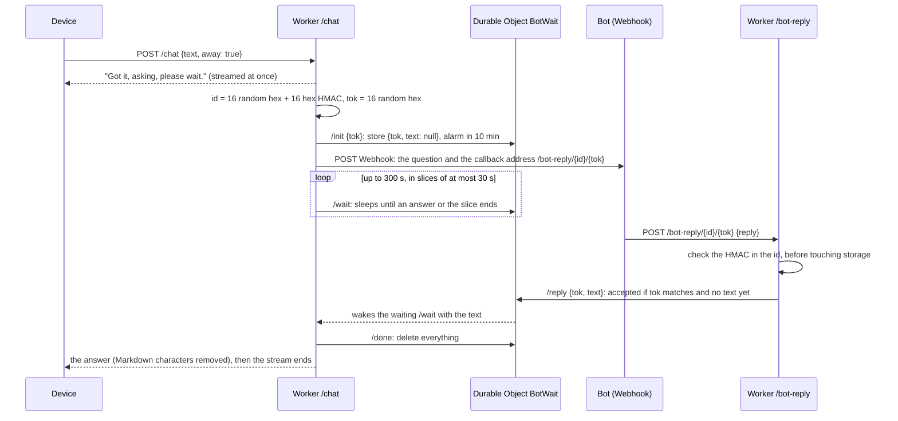

# How a Grok Bot question uses KV and Durable Objects

**English** · [中文](GROK-BOT.zh-CN.md) · [Back to README](../README.en.md)

This page explains what the cloud Worker (`worker/src/index.js`) stores while it carries one spoken question to a Webhook bot and brings the answer back: what goes into Workers KV, what goes into a Durable Object, and why the two are used for different jobs.

## What lives where

| Store | Key or object | Holds | Lifetime |
|---|---|---|---|
| KV `CFG` | `config` | The settings from the admin page (recognition, voice, callback host, WireGuard) as one JSON document | Until you change it |
| KV `CFG` | `secrets` | The Azure key, the bot's Webhook address and its credentials, as one JSON document | Until you change it |
| KV `CFG` | `avatar` | The custom picture (binary, at most 120 KB) | Until you replace it |
| KV `CFG` | `bot:<id>` | One waiting question, **only when the Durable Object is not bound** (a fallback) | 600 s (`expirationTtl`) |
| Durable Object `BotWait` | one object per question, named by the question's id | `{ tok, text }`: the one-time token and, once it arrives, the bot's answer | Deleted when the answer is read, or after 10 minutes |
| Durable Object `WgRegistry` | a single object named `registry` | The WireGuard device keys that asked for a tunnel and their addresses | Pending keys are forgotten after 7 days |

Only the first three KV keys and `BotWait` take part in a Grok Bot conversation. `WgRegistry` is for the WireGuard menu and is listed so the table is complete.

## Why a Durable Object holds the question

A question is a short exchange between two parties that never talk to each other: the Worker is waiting for an answer, and the bot (a different server, a minute later) posts it to another request. They must meet in one place that both see at once.

- **KV is eventually consistent.** A value written in one place can take up to about a minute to be visible elsewhere, and reads are cached. A bot that answers in 10 seconds would be heard after a minute. KV is the right place for settings, which change rarely, and the wrong one for this.
- **A Durable Object is one single-threaded instance** per name. The Worker's waiting request and the bot's callback both reach the same instance, which keeps a list of waiting callers in memory and wakes them the moment the answer is stored. The answer arrives in milliseconds, and "store the answer only if the token matches and nothing is stored yet" cannot race with itself.

The class is declared with `new_sqlite_classes` in `worker/wrangler.toml`: SQLite-backed Durable Objects are the kind a free Cloudflare plan can use.

## The life of one question

In words:

1. The device sends the recognised text to `/chat` with `away: true` (the Answers menu says Grok Bot). The Worker starts a streamed reply and sends one sentence at once, so the device has something to say while the bot thinks.
2. It makes the question's **id** (16 random hex digits followed by 16 hex digits of an HMAC of them, keyed with the device token) and a one-time **token** (16 random hex digits).
3. It calls the Durable Object named after the id with `/init`, which stores `{ tok, text: null }` and sets an alarm for 10 minutes.
4. It POSTs the Webhook with `Authorization: Bearer <credentials>`. The message carries the question and the callback address `<callback host>/bot-reply/<id>/<tok>`, to be used once. A non-2xx answer or a network error ends the question with `bot_unreachable`.
5. It waits: it asks the Durable Object `/wait` in slices of up to 30 seconds, for at most 300 seconds (`BOT_WAIT_MS`). Each slice returns as soon as the answer is stored.
6. The bot POSTs its answer to the callback. `botReply` first checks the HMAC in the id; an id the Worker did not make is refused before any storage is used. Then the Durable Object's `/reply` stores the text only if the token matches and no text is there yet, and wakes the waiting slice.
7. The Worker reads the text, calls `/done` (the object deletes everything), removes Markdown characters (the characters `*`, `#` and the backtick) and streams the answer to the device. If nothing arrives in 300 seconds the reply ends with `bot_timeout`.

When the question fails, the rest of the reply is not an answer: it starts with the control character `\u0001` and a short code (`bot_timeout`, `bot_unreachable`), and the firmware shows an error instead of speaking it.

## What is stored, and for how long

| Per question | Where | Notes |
|---|---|---|
| id | the object's name | Not stored as data. 32 hex digits; the first 16 are random, the last 16 prove the Worker made it |
| `tok` and `text` | Durable Object storage, key `v` | `text` is cut to 4000 characters; written once |
| An alarm | Durable Object | Deletes everything after 10 minutes if nobody reads the answer |

After the answer is read, nothing about the question is left. The settings KV keys are read on every request (`config` and `secrets`, two reads), and the edge caches them, so a change saved on the admin page can take up to about a minute to reach every request.

## The KV fallback

If the `BOT` binding is missing, the same four steps use a KV key `bot:<id>` instead: the Worker writes `{ tok, text: null }` with a 600-second expiry, polls it every 1.5 seconds, and the callback rewrites it with the answer. It works, but KV's delay means the answer can reach the device up to a minute late, and the compare-and-set is not atomic. The standard `wrangler.toml` binds the Durable Object, so this path is only for a deployment that removed it.

## Protections in this path

- **Forged callbacks cost nothing.** The id's HMAC is checked before any Durable Object is addressed, so a stranger who guesses the callback address cannot make the Worker create objects or storage.
- **One answer per question.** `/reply` needs the matching token and an empty `text`; a second post gets 403.
- **The token travels in the path**, not in a query string, because some bots HTML-escape `&` and break query strings. The older `?id=&t=` form still works.
- **Webhook and callback addresses must be `https` on a public host name** (`checkHttpsUrl`), so the bot's credentials cannot be sent to an address inside a network.
- **Limits:** the question is at most 1000 characters, the answer 4000, and the whole wait 300 seconds.

## Reading the logs

`wrangler tail` shows `bot webhook <status>` for each call to the bot. A callback answered with 403 means the id or token is wrong, expired (10 minutes) or already used. A question that always ends in `bot_timeout` usually means the bot cannot reach the callback host name; check the "outside addresses it may call" list of the bot.

## Cost

One question makes about four or five Durable Object requests (`/init`, one or two `/wait`, `/reply`, `/done`) and two KV reads. Cloudflare's free allowances and prices change; check their current pages before relying on a number.
