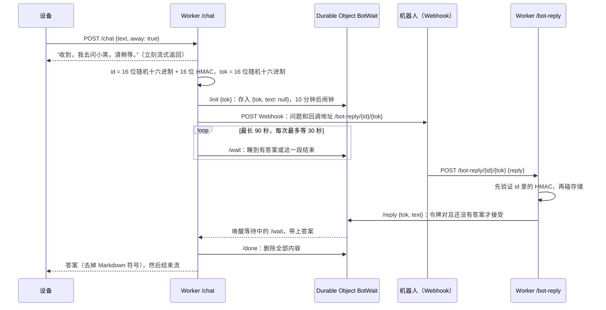

# 一次 Grok Bot 提问如何用到 KV 和 Durable Object

[English](GROK-BOT.md) · **中文** · [返回 README](../README.md)

这篇文档说明云端 Worker（`worker/src/index.js`）在把一句语音提问送给 Webhook 机器人、再把答案取回来的过程中，各存了什么：哪些放在 Workers KV，哪些放在 Durable Object，以及为什么两者分工不同。

## 什么放在哪里

| 存储 | 键或对象 | 存的内容 | 保存多久 |
|---|---|---|---|
| KV `CFG` | `config` | 管理页的设置（识别、声音、回调主机、WireGuard），一个 JSON | 直到你改动 |
| KV `CFG` | `secrets` | Azure 密钥、机器人的 Webhook 地址和授权凭据，一个 JSON | 直到你改动 |
| KV `CFG` | `avatar` | 自定义图片（二进制，最大 120 KB） | 直到你替换 |
| KV `CFG` | `bot:<id>` | 一个等待中的提问，**仅在没有绑定 Durable Object 时**才用（备用路径） | 600 秒（`expirationTtl`） |
| Durable Object `BotWait` | 每个提问一个对象，以提问 id 命名 | `{ tok, text }`：一次性令牌，以及机器人的答案（到达后） | 答案被读走后删除，或 10 分钟后删除 |
| Durable Object `WgRegistry` | 一个叫 `registry` 的对象 | 申请隧道的 WireGuard 设备密钥和分到的地址 | 未批准的密钥 7 天后遗忘 |

Grok Bot 对话只用到前三个 KV 键和 `BotWait`。`WgRegistry` 属于 WireGuard 菜单，列在这里只是为了表格完整。

## 为什么用 Durable Object 存提问

一次提问是两个互相看不见对方的角色之间的短暂交接：Worker 在等答案，而机器人（另一台服务器，可能过一阵子）用另一个请求把答案送来。双方必须在一个两边同时看得到的地方碰头。

- **KV 是最终一致的。** 一处写入的值，到别处可见最长要约一分钟，读取还有缓存。机器人 10 秒就答好了，设备却要一分钟后才听到。KV 适合很少改动的设置，不适合这件事。
- **Durable Object 是同名唯一的单线程实例。** Worker 等答案的请求和机器人的回调，都会到达同一个实例。它在内存里记着等待的请求，答案一存进去就立刻唤醒。答案以毫秒级到达，而且“令牌对得上、并且还没有答案，才写入”这一步不会和自己抢。

`worker/wrangler.toml` 里这个类用 `new_sqlite_classes` 声明：基于 SQLite 的 Durable Object 才是 Cloudflare 免费方案可以使用的那一种。

## 一次提问的完整过程

用文字说一遍：

1. 设备把识别出的文字发到 `/chat`，带 `away: true`（Answers 菜单选的是 Grok Bot）。Worker 开始流式回复，并立刻说一句话，让设备在机器人思考期间有话可念。
2. 它生成这次提问的 **id**（16 位随机十六进制，后面接上用设备令牌做密钥对它计算的 16 位 HMAC）和一个一次性**令牌**（16 位随机十六进制）。
3. 它用 `/init` 调用以 id 命名的 Durable Object，对象存入 `{ tok, text: null }`，并设一个 10 分钟的闹钟。
4. 它用 `Authorization: Bearer <凭据>` 向 Webhook 发 POST。消息里有问题和回调地址 `<回调主机>/bot-reply/<id>/<tok>`，只用一次。如果机器人返回非 2xx 或网络出错，这次提问以 `bot_unreachable` 结束。
5. 它开始等：每次向 Durable Object 发 `/wait`，最多等 30 秒，总共最长 90 秒（`BOT_WAIT_MS`）。答案一存进去，这一段就立刻返回。
6. 机器人把答案 POST 到回调地址。`botReply` 先验证 id 里的 HMAC，不是 Worker 生成的 id 会在碰任何存储之前被拒绝。然后 Durable Object 的 `/reply` 只在令牌对得上、并且还没有文字时才写入，并唤醒等待中的那一段。
7. Worker 读到文字后调用 `/done`（对象删除全部内容），去掉 Markdown 符号（星号、井号和反引号），把答案流式送给设备。如果 90 秒内没有答案，回复以 `bot_timeout` 结束。

提问失败时，回复的剩余部分不是答案：它以控制字符 `\u0001` 加一个短代码（`bot_timeout`、`bot_unreachable`）开头，固件会显示错误，而不是把它念出来。

## 存了什么、存多久

| 每个提问 | 位置 | 说明 |
|---|---|---|
| id | 对象的名字 | 不作为数据存放。32 位十六进制，前 16 位随机，后 16 位证明是 Worker 生成的 |
| `tok` 和 `text` | Durable Object 存储，键 `v` | `text` 最多 4000 字，只写一次 |
| 一个闹钟 | Durable Object | 如果没人读走答案，10 分钟后删除全部内容 |

答案被读走后，关于这次提问的东西一点不剩。设置类的 KV 键（`config` 和 `secrets`）每个请求都会读取，共两次，边缘节点会缓存它们，所以在管理页保存的改动，最多要约一分钟才对所有请求生效。

## KV 备用路径

如果没有绑定 `BOT`，同样这几步会改用 KV 键 `bot:<id>`：Worker 写入 `{ tok, text: null }`，有效期 600 秒，每 1.5 秒轮询一次，回调时把答案重写进去。这条路能走通，但 KV 的延迟会让答案最多晚一分钟到设备，比较和写入也不是原子的。标准的 `wrangler.toml` 绑定了 Durable Object，所以这条路只留给去掉了它的部署。

## 这条路径上的保护

- **伪造的回调不花任何成本。** 在访问任何 Durable Object 之前，先验证 id 的 HMAC，所以陌生人猜出回调地址，也无法让 Worker 创建对象或占用存储。
- **一个提问只收一个答案。** `/reply` 需要匹配的令牌和空的 `text`；第二次 POST 会得到 403。
- **令牌放在路径里**，不放在查询参数里，因为有的机器人会把 `&` 做 HTML 转义，破坏查询字符串。旧的 `?id=&t=` 形式仍然可用。
- **Webhook 和回调地址必须是公网域名上的 `https`**（`checkHttpsUrl`），这样机器人的凭据不会被发到内网地址。
- **限制：** 提问最多 1000 字，答案最多 4000 字，整个等待最长 90 秒。

## 看日志

`wrangler tail` 会对每次调用机器人显示 `bot webhook <状态码>`。回调得到 403，说明 id 或令牌不对、已过期（10 分钟）或已经用过。一个提问总是以 `bot_timeout` 结束，通常是机器人到不了回调所用的主机名；请检查机器人“允许访问的外部地址”列表。

## 费用

一个提问大约产生四到五次 Durable Object 请求（`/init`、一到两次 `/wait`、`/reply`、`/done`）和两次 KV 读取。Cloudflare 的免费额度和价格会变化，使用任何数字前请先查它们当前的页面。
